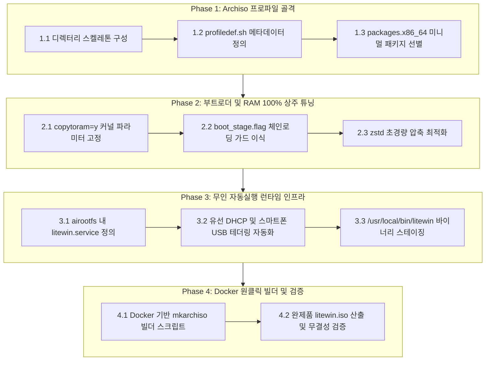

# Litewin Archiso 패키징 및 RAM 부팅 파이프라인 구축 로드맵

- **목표**: Linux 6.12+ 최신 커널과 Wi-Fi 7 / Intel VMD 지원을 갖춘 Arch Linux(Archiso) 베이스로, 부팅 즉시 100% RAM 상주(`copytoram=y`)하여 무인 Windows 배포기(`litewin`)를 자동 실행하는 초경량 완제품 ISO(`litewin.iso`)를 빌드합니다.
- **호스트 독립성**: Docker(`archlinux:latest`) 컨테이너 기반으로 호스트 OS(Ubuntu, Debian, Fedora 등) 환경에 구애받지 않고 어디서나 단일 명령어로 재현 가능하게 빌드합니다.

---

## 1. 세부 단계별 구현 명세 (11 Sub-Milestones)



---

### [Phase 1] Archiso 프로파일 및 최소 패키지 디스크립터

#### 1.1 디렉터리 스켈레톤 구성 (`packaging/archiso/`)
- 다음 디렉터리 레이아웃 생성:
  ```text
  packaging/archiso/
  ├── profiledef.sh
  ├── packages.x86_64
  ├── grub/
  │   └── grub.cfg
  ├── efiboot/
  │   └── loader/
  │       ├── loader.conf
  │       └── entries/
  │           └── litewin.conf
  └── airootfs/
      └── etc/
          └── systemd/
              └── system/
                  ├── litewin.service
                  └── multi-user.target.wants/
                      └── litewin.service -> ../litewin.service
  ```

#### 1.2 프로파일 메타데이터 정의 (`profiledef.sh`)
- `iso_name="litewin"`
- `iso_label="LITEWIN_LIVE"`
- `iso_version="2026.11"`
- `arch="x86_64"`
- `airootfs_image_type="squashfs"`
- `airootfs_image_tool_options=('-comp' 'zstd' '-Xcompression-level' '19' '-b' '1M')`
- `file_permissions`:
  - `["/usr/local/bin/litewin"]="0:0:0755"`
  - `["/etc/systemd/system/litewin.service"]="0:0:0644"`

#### 1.3 미니멀 패키지 목록 선별 (`packages.x86_64`)
- **커널 및 하드웨어 펌웨어**:
  - `linux` (최신 6.12+ 커널)
  - `linux-firmware` (Intel AX211, BE200 Wi-Fi 7 및 VMD 드라이버)
  - `wireless-regdb`
- **디스크 및 배포 툴체인**:
  - `wimlib` (`wimlib-imagex apply`용)
  - `util-linux` (`sfdisk`, `lsblk`, `wipefs`)
  - `ntfs-3g` (`mkfs.ntfs`)
  - `dosfstools` (`mkfs.fat`)
  - `efibootmgr` (UEFI NVRAM 등록)
  - `parted`
- **네트워킹 및 필수 런타임**:
  - `iwd` (초경량 Wi-Fi 관리자)
  - `dhcpcd`
  - `iproute2`
  - `curl`
  - `openssl`
  - `glibc`
- **용량 목표**: GUI, man 페이지, 문서 제외로 350~450MB 유지.

---

### [Phase 2] 부트로더 및 RAM 100% 상주 튜닝

#### 2.1 `copytoram=y` 커널 파라미터 고정
- 모든 부트 엔트리 커널 옵션에 다음 파라미터 적용:
  ```text
  archisobasedir=arch archisolabel=LITEWIN_LIVE copytoram=y quiet loglevel=3 audit=0 udev.log_priority=3
  ```
- **효과**: 부팅 직후 SquashFS가 시스템 RAM으로 100% 로드되어 USB 분리 후에도 안전 작동 보장.

#### 2.2 USB 재부팅 루프 방어 가드 (Dual-Bootloader)
- `grub/grub.cfg` 최상단에 마커 감지 로직 적용:
  ```grub
  search --file --no-floppy --set=internal_esp /EFI/Litewin/boot_stage.flag
  if [ -n "$internal_esp" ]; then
      menuentry "Boot Installed Windows (Auto-Handoff from USB)" {
          chainloader ($internal_esp)/EFI/BOOT/BOOTX64.EFI
          boot
      }
  fi
  ```

#### 2.3 zstd 초경량 압축 최적화
- SquashFS 압축 레벨 19 적용으로 USB I/O 읽기 및 RAM 언패킹 지연 최소화.

---

### [Phase 3] 무인 자동 실행 및 런타임 환경 구성 (`airootfs`)

#### 3.1 자동 실행 시스템 서비스 등록 (`airootfs/etc/systemd/system/litewin.service`)
- `StandardInput=tty`, `StandardOutput=tty`, `TTYPath=/dev/tty1`로 대화형 콘솔 연결.
- 실행 명령어: `ExecStart=/usr/local/bin/litewin`
- `WantedBy=multi-user.target`

#### 3.2 제로 콘피그 네트워크 환경 구성
- 유선 랜 자동 연결 (`systemd-networkd` DHCP).
- 스마트폰 USB 테더링(RNDIS, CDC-NCM, iPhone) 연결 즉시 자동 온라인화.

#### 3.3 바이너리 스테이징 규칙
- 빌드된 `build/litewin` 바이너리를 `airootfs/usr/local/bin/litewin`으로 복사.

---

### [Phase 4] 호스트 독립적 Docker 기반 ISO 원클릭 빌더

#### 4.1 Docker 빌더 스크립트 작성 (`scripts/build_iso_docker.sh`)
- 공식 `archlinux:latest` 컨테이너를 구동하여 격리된 환경에서 `mkarchiso` 실행:
  ```bash
  docker run --rm --privileged \
    -v "${PROJECT_ROOT}/packaging/archiso:/profile:ro" \
    -v "${PROJECT_ROOT}/build/iso_out:/out" \
    -v "${PROJECT_ROOT}/build/litewin:/profile/airootfs/usr/local/bin/litewin:ro" \
    archlinux:latest bash -c "pacman -Syu --noconfirm archiso && mkarchiso -v -w /tmp/archiso-tmp -o /out /profile"
  ```

#### 4.2 완제품 산출 및 검증 (`scripts/verify_iso.sh`)
- 산출물: `build/iso_out/litewin-*.iso` 및 `SHA256SUMS`.
- `isoinfo` 또는 마운트를 통해 커널(`vmlinuz-linux`), initramfs, `litewin` 실행 파일 무결성 자동 검증.

---

## 2. 아르곤(Gemini 4 Argon) 구현 요청 프롬프트

아르곤에게 아래 프롬프트를 전달하여 단계별로 구현을 요청할 수 있습니다:

```text
@docs/archiso_packaging_roadmap.md 파일을 확인해줘.

우리는 Litewin C++ 배포 바이너리 개발을 완료했고, 이제 최신 하드웨어(Wi-Fi 7, Intel VMD)와 100% RAM 상주(copytoram=y)를 지원하는 Archiso 기반 부팅 ISO를 구축해야 해.

문서의 [Phase 1]부터 [Phase 4]까지 차례대로 구현해줘:
1. Phase 1: packaging/archiso/profiledef.sh 및 packages.x86_64 생성
2. Phase 2: packaging/archiso/grub/grub.cfg (boot_stage.flag 체인로딩 가드) 및 systemd-boot 엔트리 작성
3. Phase 3: packaging/archiso/airootfs/etc/systemd/system/litewin.service 자동실행 서비스 작성
4. Phase 4: 호스트 OS 상관없이 Docker(archlinux:latest) 컨테이너에서 mkarchiso를 실행하는 scripts/build_iso_docker.sh 작성
```
