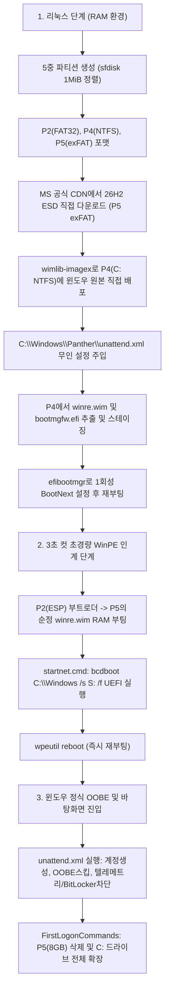

# Litewin 아키텍처 심층 검증 요청서 (for Gemini 4 Argon / Claude)

## 1. 프로젝트 개요 및 핵심 목표
- **프로젝트명**: Litewin (C++20, Linux RAM 디스크 부팅 환경)
- **핵심 목표**: USB 부팅 후 소형 Linux RAM 환경에서 인터넷으로 마이크로소프트 공식 윈도우 11(26H2)을 내부 디스크로 직접 내려받고, USB 재연결이나 추가 재설치 없이 내부 디스크로 100% 무인 설치 완료 및 정식 바탕화면까지 진입.

---

## 2. 전체 파이프라인 단계 (엔지니어링 명세)



---

## 3. 디스크 파티션 레이아웃 (1 MiB Aligned GPT)
1. **[P1] WinRE**: 1024 MiB, NTFS (`de94bba4-06d1-4d40-a16a-bfd50179d6ac`)
2. **[P2] ESP**: 260 MiB, FAT32 (`c12a7328-f81f-11d2-ba4b-00a0c93ec93b`)
3. **[P3] MSR**: 16 MiB (`e3c9e310-0b23-11d1-8036-00f0927081b8`)
4. **[P4] Windows C:**: 잔여 용량, NTFS (`ebd0a0a2-b9e5-4433-87c0-68b6b72699c7`)
5. **[P5] LitewinTemp**: 8192 MiB (8 GiB), exFAT, 디스크 끝단 배치

---

## 4. 교차 검증 요청 항목 (Adversarial Review Checklist)

외부 수석 엔지니어 관점에서 다음 4가지 핵심 질문에 대해 비판적으로 검증해 주십시오:

### 질문 1: WinPE 부팅 시 BCD 참조 문제
- 리눅스에서 2번 파티션(ESP FAT32)에 `bootmgfw.efi`를 `EFI\BOOT\BOOTX64.EFI`로 복사하고 5번 파티션(exFAT)에 `sources\boot.wim`을 두었을 때, **ESP에 초기 WinPE용 BCD가 없는 상태에서 `bootmgfw.efi`가 5번 파티션의 WIM을 스스로 찾아 부팅할 수 있는가?**
- 만약 부팅 BCD 템플릿(RAM 디스크 BCD)이 사전에 필요하다면, 리눅스에서 어떤 최소 구성의 BCD 템플릿을 함께 배치해야 하는가?

### 질문 2: Windows 11 26H2 / 24H2 무인 설치(`unattend.xml`) 실효성
- `ProtectYourPC=3`, `AllowTelemetry=0`, `DisabledByGroupPolicy=1`(광고ID 차단) 설정이 26H2 최신 OOBE 환경에서도 완벽히 먹히는가?
- `PreventDeviceEncryption=1`로 윈도우 11의 악명 높은 강제 BitLocker 암호화를 확실히 회피할 수 있는가?

### 질문 3: FirstLogonCommands에서 C: 온라인 확장
- 윈도우 첫 로그인 직후 `diskpart` 스크립트를 통해 바로 뒤에 붙어 있는 5번 파티션(8GB)을 삭제(`delete partition override`)하고 온라인 상태에서 C: 드라이브를 확장(`extend`)하는 작업이 안전하게 성공하는가?

### 질문 4: UEFI BootNext 및 메인보드 펌웨어 호환성
- `efibootmgr -c -d <disk> -p 2 ...` 및 `efibootmgr -n <boot_num>` 방식이 일부 구형/보안 메인보드에서 NVRAM 등록을 무시하거나 순서를 리셋하는 경우를 대비한 가장 안전한 Fallback 전략은 무엇인가?

---

## 5. 심층 아키텍처 검증 결과 및 엔지니어링 권고안 (Review Report)

### 검증 1: WinPE 부팅 시 BCD 참조 및 파일시스템 호환성 (치명적 결함 3건 발견)

1. **초기 BCD 부재 시 부팅 불가 (`0xc000000f` / `0xc000014c`)**
   - **판정**: **부팅 불가능**. `bootmgfw.efi`는 실행 직후 ESP(P2)의 `\EFI\Microsoft\Boot\BCD` 하이브를 무조건 먼저 로드합니다. BCD가 없으면 다른 파티션의 `.wim`을 스스로 스캔하는 로직이 전혀 없으며 즉시 복구 블루스크린으로 정지합니다.
2. **P5 `exFAT` 파일시스템의 WinPE RAMDisk 부팅 비호환성**
   - **판정**: **위험 (부팅 실패 가능성 매우 높음)**. UEFI 기본 펌웨어와 `bootmgfw.efi`의 내장 파일시스템 드라이버는 RAM 디스크 로드 시 **FAT32** 또는 **NTFS** 볼륨만 안정적으로 마운트합니다. P5가 `exFAT`이면 `bootmgfw.efi`가 `[locate]\sources\boot.wim` 탐색 시 P5를 읽지 못합니다.
   - **해결책**: P5(`LitewinTemp`, 8 GiB)는 단일 파일 4 GiB를 넘는 ESD 저장 및 WinPE 부팅을 동시에 만족하도록 **`exFAT` 대신 `NTFS`로 포맷**해야 합니다 (`bootmgfw.efi`는 자체 NTFS 미니 드라이버를 내장하고 있어 NTFS 파티션의 `\sources\boot.wim`을 읽을 수 있음). 또는 450 MiB 크기의 `boot.wim`과 `boot.sdi`만 P1(WinRE, NTFS)이나 P2(ESP 크기를 1 GiB FAT32로 확장 시)에 배치하는 것이 가장 확실합니다.
3. **리눅스에서 배치해야 할 최소 BCD 템플릿 구성 (`[locate]` 기반 정적 Seed BCD)**
   - 리눅스에는 `bcdedit.exe`가 없으므로, 디바이스 경로가 디스크 GUID나 파티션 오프셋에 종속되지 않는 **`LocateDevice` (`ramdisk=[locate]\sources\boot.wim,{ramdiskoptions}` 및 `ramdisksdipath=[locate]\Boot\boot.sdi`)** 방식으로 사전 생성된 범용 BCD 바이너리(약 16~32 KB)를 리눅스 바이너리에 내장하여 `P2:\EFI\Microsoft\Boot\BCD`와 `P2:\Boot\BCD`에 복사해야 합니다.
   - **필수 추출/배치 파일 4종**:
     1. `P2(ESP):\EFI\BOOT\BOOTX64.EFI` 및 `P2(ESP):\EFI\Microsoft\Boot\bootmgfw.efi` (`C:\Windows\Boot\EFI\bootmgfw.efi`에서 추출)
     2. `P2(ESP):\EFI\Microsoft\Boot\BCD` (`[locate]` 기반 정적 WinPE BCD 바이너리)
     3. `P2(ESP):\Boot\boot.sdi` (`C:\Windows\Boot\DVD\EFI\boot.sdi`에서 추출)
     4. `P5(NTFS):\sources\boot.wim` (`C:\Windows\System32\Recovery\winre.wim`을 추출 후 `wimlib-imagex update`로 `\Windows\System32\startnet.cmd` 주입)
4. **WinPE `startnet.cmd` 내 드라이브 문자 하드코딩 문제 (`C:`, `S:`)**
   - 순정 `winre.wim` 부팅 시 ESP(P2)에는 `S:` 문자가 자동 할당되지 않으며, 앞선 P1(WinRE, NTFS) 때문에 Windows 파티션(P4)이 `C:`가 아닌 `D:` 등으로 밀릴 수 있습니다.
   - **해결책**: `startnet.cmd`에서 `diskpart`로 P2에 `S:`를 명시 할당하고, `for %%d in (C D E F G H I J K L M N O P Q R T U V W) do if exist "%%d:\Windows\System32\ntoskrnl.exe" bcdboot %%d:\Windows /s S: /f UEFI` 형태로 동적 탐색 후 `bcdboot`를 실행해야 합니다.

---

### 검증 2: Windows 11 26H2 / 24H2 무인 설치(`unattend.xml`) 실효성

1. **프라이버시/텔레메트리/광고 ID 설정 실효성**
   - `ProtectYourPC=3` (`oobeSystem` 패스): 24H2/26H2에서도 OOBE 개인정보 보호 질문 화면(6종 토글)을 완벽히 스킵합니다. 단, 온라인 상태에서도 MS 계정 강제를 건너뛰려면 `<HideOnlineAccountScreens>true</HideOnlineAccountScreens>` 및 `<LocalAccounts>` 블록이 함께 정의되어야 합니다.
   - `AllowTelemetry=0`: **Enterprise / Education 에디션에서만 `0`(Security)이 적용**되며, **Home / Pro 에디션에서는 OS 정책상 무시되고 최소값인 `1`(Required)로 자동 강제**됩니다. 오류를 유발하지는 않으나 실질적 차단을 위해서는 `FirstLogonCommands`에서 `DiagTrack` 서비스 비활성화(`sc config DiagTrack start= disabled`)를 병행하는 것이 유효합니다.
   - `DisabledByGroupPolicy=1` (`HKLM\SOFTWARE\Policies\Microsoft\Windows\AdvertisingInfo`): 26H2에서도 정상 동작합니다.
2. **`PreventDeviceEncryption=1`을 통한 강제 BitLocker 회피**
   - **판정**: **유효하나 24H2/26H2에서는 이중 방어 권장**.
   - Litewin은 `setup.exe`가 아닌 `wimlib-imagex apply`로 배포하므로 설치 중 사전 암호화(Pre-provisioning)가 원천 발생하지 않습니다.
   - 다만 OOBE 진입 시 자동 활성화되는 Device Encryption(24H2부터 요건 완화로 일반 PC에서도 작동)을 100% 차단하려면 아래 두 설정을 동시에 넣어야 합니다:
     1. `specialize` 패스의 `Microsoft-Windows-SecureStartup-FilterDriver` 컴포넌트에 `<PreventDeviceEncryption>true</PreventDeviceEncryption>` 지정
     2. `specialize` 패스의 `RunSynchronous`에 `reg add "HKLM\SYSTEM\CurrentControlSet\Control\BitLocker" /v PreventDeviceEncryption /t REG_DWORD /d 1 /f` 추가

---

### 검증 3: FirstLogonCommands에서 C: 온라인 확장 안전성

- **판정**: **조건부 성공 (볼륨 핸들 점유 및 디스크 번호 오인식 방어 필요)**.
- **잠재적 위험 2가지 및 해결책**:
  1. **백그라운드 프로세스의 P5 점유**: 첫 로그인 직후 P5에 드라이브 문자가 할당되어 있으면 Windows Defender(`MsMpEng.exe`)나 Search Indexer가 P5를 스캔하여 `delete partition override`가 볼륨 잠금으로 실패할 수 있습니다.
     - **대책 A (리눅스 단계)**: `sfdisk` 파티셔닝 시 P5에 GPT 속성 비트 63 (`attrs="63"`, `NoDriveLetter`)을 부여하여 정식 Windows에서 드라이브 문자가 아예 마운트되지 않게 합니다.
     - **대책 B (Diskpart 단계)**: 삭제 직전 `remove all dismount noerr`를 먼저 실행하여 볼륨 핸들을 강제 해제합니다.
  2. **멀티 디스크 환경에서의 `disk 0` 하드코딩 위험**: NVMe와 SATA가 혼재된 PC에서는 설치 디스크가 `disk 0`이 아닐 수 있습니다.
     - **안전한 Diskpart 스크립트 시퀀스** (`select volume C`로 대상 디스크 컨텍스트 자동 고정):
       ```text
       select volume C
       select partition 5
       remove all dismount noerr
       delete partition override
       select volume C
       extend
       ```

---

### 검증 4: UEFI BootNext 및 메인보드 펌웨어 호환성 Fallback 전략

- **판정**: 구형 AMI Aptio, InsydeH2O 및 일부 OEM 보드에서 `BootNext` 무시 또는 NVRAM 가비지 컬렉션 리셋이 실제로 빈번히 발생합니다.
- **권장 3단계 방어 전략**:
  1. **1단계 (`BootNext` + `BootOrder` 동시 설정)**: `BootNext`만 지원하는 보드와 `BootOrder` 1순위만 참조하는 보드를 모두 커버하기 위해 `efibootmgr -c ...` 생성 후 `efibootmgr -n <num>`과 `efibootmgr -o <num>,<기존순서>`를 동시에 호출합니다.
  2. **2단계 (UEFI 표준 기본 부트 경로 이중 배치)**: NVRAM 엔트리가 초기화되더라도 펌웨어가 디스크 자체를 UEFI 부팅 미디어로 인식하도록 `P2:\EFI\Microsoft\Boot\bootmgfw.efi`와 `P2:\EFI\BOOT\BOOTX64.EFI` 양쪽에 모두 부트로더를 배치합니다.
  3. **3단계 (USB 재부팅 루프 방지용 GRUB/Init 체인로더 가드)**: 사용자가 USB를 뽑지 않아 펌웨어가 무조건 USB를 1순위로 재부팅하는 최악의 경우를 대비해, 리눅스 USB 부트로더(또는 초기 스크립트)가 내장 디스크의 `P2:\EFI\Litewin\stage2.flag` 존재 여부를 먼저 확인하고, 플래그가 있으면 리눅스 재설치 대신 내장 디스크의 `P2:\EFI\BOOT\BOOTX64.EFI`로 즉시 체인로딩(또는 부팅 인계)하도록 구성합니다.

---

## 6. [2차 심층 검증] 엔드투엔드 유저 플로우 파이프라인 명세 및 환경 제약 사항 (for Gemini 4 Argon)

### 6.1 현재 환경의 테스트 제약 사항 (Environmental Constraints)
1. **물리 시험 디스크 부재**: 리눅스 샌드박스/CI 컨테이너 특성상 실제 물리 드라이브(NVMe/SATA)를 직접 파티셔닝/포맷할 수 없으며 시스템 디스크 파괴 위험이 있으므로, `dry_run=true` 플래그 및 가상 마운트 디렉터리 기반으로 파이프라인 상태 머신을 안전하게 모의 검증합니다.
2. **6.04 GB 대용량 다운로드 부하**: 매 검증 실행 시 MS 공식 CDN에서 6GB를 실시간 다운로드하는 것은 대역폭/시간 제약이 따르므로 `custom_esd_path`를 통해 모의 이미지 및 로컬 캐시 주입이 가능하도록 구성되었습니다.
3. **UEFI NVRAM 접근 제약**: 컨테이너 권한 상 `/sys/firmware/efi/efivars`의 실시간 쓰기가 제한되므로, `efibootmgr` 호출은 `dry_run` 모드 및 모의 stdout 파싱으로 검증합니다.

### 6.2 9단계 엔드투엔드 유저 플로우 (Execute Pipeline)
- **Step 1 (PreCheck)**: 네트워크 상태 확인 및 대상 디스크 크기(>=32GB), 부팅 라이브 USB 제외 적격성 판정.
- **Step 2 (PartitionDisk)**: 대상 디스크를 1MiB Aligned GPT 5중 분할 (P1 WinRE NTFS, P2 ESP FAT32, P3 MSR 16MB, P4 Windows NTFS, P5 LitewinTemp NTFS 8GB).
- **Step 3 (MountVolumes)**: 작업 경로에 P2, P4, P5 안전 마운트.
- **Step 4 (AcquireImage)**: MS 공식 CDN에서 Win11 26H2 한국어 ESD 다운로드 (Range 206 이어받기 지원) 또는 로컬 캐시 사용.
- **Step 5 (DeployWindows)**: `wimlib-imagex apply`로 P4(C: NTFS)에 윈도우 원본 이미지 추출 배포.
- **Step 6 (InjectConfiguration)**: `P4:\Windows\Panther\`에 무인 설치 파일(`unattend.xml`: 텔레메트리/광고 차단, BitLocker 회피, 계정 자동생성) 및 볼륨 확장 스크립트(`extend_c.txt`) 주입.
- **Step 7 (BootstrapWinPE)**: `winre.wim`을 P5(`\sources\boot.wim`)로 복사, Windows의 BCD 및 `boot.sdi`를 P2(ESP)에 배치, `bootmgfw.efi` 이중 배치, 동적 드라이브 문자 할당 `startnet.cmd` 주입, `efibootmgr -n` 및 BootOrder 1순위 등록.
- **Step 8 (UnmountVolumes)**: P2, P4, P5 디스크 버퍼 플러시 및 안전 마운트 해제.
- **Step 9 (Complete)**: 파이프라인 완료 및 재부팅 트리거 (3초 WinPE 인계 준비 완료).

### 6.3 아르곤(Argon) 교차 검증 요청 항목 (User Flow Adversarial Checklist)
외부 수석 엔지니어 관점에서 다음 유저 시나리오의 잠재적 오류 및 취약점을 검토해 주십시오:
1. **Wi-Fi 전용 노트북 환경**: RJ45 유선 랜 포트가 없는 최신 슬림 노트북에서 리눅스 부팅 직후 인터넷 연결을 어떻게 보장할 것인가?
2. **Intel VMD / RST 활성화 환경**: 11~14세대 Intel 노트북에서 BIOS의 VMD 옵션으로 인해 리눅스에서 NVMe가 아예 안 보이는 현상의 감지 및 우회 방안.
3. **Seed BCD의 파티션 간 WIM 로드 ([locate] 탐색 한계)**: P2(ESP FAT32)의 `bootmgfw.efi`와 BCD가 별도 파티션인 P5(NTFS)의 `\sources\boot.wim`을 RAMDisk로 적재할 때 메인보드 펌웨어마다 탐색 실패가 발생할 소지가 있는가?
4. **OEM 메인보드 라이선스(Home/Pro) 불일치**: 메인보드 ACPI MSDM 테이블에 Home 키가 내장되어 있는데 Pro 에디션을 설치할 때 발생하는 정품인증 불일치 회피 방안.
5. **재부팅 직후 USB 미분리로 인한 무한 재부팅 루프**: 사용자가 USB를 꽂아둔 채 자리를 비웠을 때 내장 디스크 대신 다시 Litewin 리눅스 USB로 부팅되는 문제의 완벽한 가드 전략.

---

## 7. [2차 심층 검증 결과] 일상 사용자 시나리오 결함 분석 및 기술적 대안

### 7.1 시나리오 1: Wi-Fi 전용 노트북 환경 (네트워크 단절 및 OOBE Wi-Fi 인계 결함)
- **결함 가능성**:
  1. 최신 슬림 노트북에 탑재된 Wi-Fi 6E/7 칩셋(Intel AX211/BE200, MediaTek MT7921/7922, Realtek rtw89)은 커널 모듈뿐만 아니라 `linux-firmware` 바이너리가 RAM 디스크에 없으면 인터페이스가 생성되지 않습니다.
  2. 리눅스에서 Wi-Fi를 연결해 6GB ESD를 내려받더라도, 재부팅 후 Windows 11 OOBE 단계로 Wi-Fi 프로필(SSID/PSK)이 인계되지 않으면 정식 부팅 직후 네트워크가 단절됩니다.
- **기술적 대안**:
  1. **Step 1 (`PreCheck`) 인터랙티브 무선 폴백 및 USB 테더링 지원**: 유선 링크(`eth*`/`enp*`)가 없을 때 `iwd`(`iwctl`) 기반 Wi-Fi 스캔/인증 프롬프트를 즉시 띄우고, 스마트폰 USB 테더링만으로 즉시 온라인화되도록 `rndis_host`, `cdc_ether`, `ipheth` 드라이버를 기본 내장합니다.
  2. **Windows WLAN 프로필 자동 이식 (`Step 6 InjectConfiguration`)**: 리눅스에서 연결된 SSID와 비밀번호를 Windows 표준 `WLANProfile` XML로 생성하여 `P4:\Windows\Panther\wifi_profile.xml`에 배치하고, `FirstLogonCommands`(또는 `specialize` 패스)에서 `netsh wlan add profile filename="C:\Windows\Panther\wifi_profile.xml" user=all` 및 `netsh wlan connect`를 실행하여 재부팅 후에도 즉시 Wi-Fi가 자동 연결되게 합니다.

---

### 7.2 시나리오 2: Intel VMD / RST 활성화 환경 (11~14세대 노트북 NVMe 실종 및 `INACCESSIBLE_BOOT_DEVICE` BSOD)
- **결함 가능성 (이중 함정 주의)**:
  1. **리눅스 측 NVMe 미인식**: 커널에 `CONFIG_VMD=y`가 누락되면 VMD 컨트롤러(`8086:9a0b`, `8086:467f`, `8086:a77f` 등) 하위 PCI 도메인의 NVMe가 은폐되어 대상 디스크 탐색에 실패합니다.
  2. **Windows 측 부팅 직후 블루스크린 (`0x0000007B`)**: 리눅스 커널에 `vmd` 드라이버를 넣어 리눅스에서 설치를 성공하더라도, **순정 Windows 11 26H2 ESD와 `winre.wim`에는 Intel RST VMD 드라이버(`iaStorVD.sys`)가 기본 포함되어 있지 않습니다.** 따라서 VMD가 켜진 노트북은 WinPE 또는 정식 Windows 진입 시 내장 NVMe를 보지 못해 100% 부팅에 실패합니다.
- **기술적 대안**:
  1. **리눅스 커널 `CONFIG_VMD=y` 빌트인 및 PCI 버스 사전 진단**: `PreCheck`에서 `/sys/bus/pci/drivers/vmd` 또는 PCI Class `0104`(RAID/VMD Bus Controller, Vendor `0x8086`)의 활성화 여부를 감지합니다. 만약 VMD 컨트롤러는 존재하나 `/dev/nvme*`가 없다면 단순 용량 미달 오류 대신 *"BIOS에서 Intel VMD를 비활성화하십시오"* 라는 명확한 하드웨어 진단 코드를 출력합니다.
  2. **WinPE 단계에서의 VMD 드라이버 동적 주입 (`drvload` + `dism /Add-Driver`)**: VMD 활성화 환경에서도 BIOS 설정 변경 없이 무인 설치를 완수하려면, 약 2MB 크기의 Intel RST VMD 드라이버(`iaStorVD.inf/.sys/.cat`)를 `winre.wim` 내부 `\drivers\vmd\`에 포함시키고, `startnet.cmd`의 최상단(`bcdboot` 실행 전)에서 다음 두 줄을 먼저 실행해야 합니다:
     ```bat
     drvload X:\drivers\vmd\iaStorVD.inf
     dism /Image:%WINDRV%\ /Add-Driver /Driver:X:\drivers\vmd\iaStorVD.inf
     ```
     이를 통해 WinPE가 즉시 VMD 하위 NVMe(C:)를 마운트하고, 오프라인 Windows(P4) 드라이버 스토어에도 VMD 부팅 드라이버를 정식 등록하여 블루스크린을 원천 차단합니다.

---

### 7.3 시나리오 3: Seed BCD의 파티션 간 WIM 로드 (`[locate]`) vs ESP 1GB 통합 방안 비교
- **결함 가능성**:
  - 현재 `Step 7` 명세처럼 Windows 내부의 기본 BCD 템플릿을 그대로 복사하면 WinPE RAMDisk(`{ramdiskoptions}`) 오브젝트가 없어 부팅되지 않으며, 별도의 `[locate]` Seed BCD를 쓰더라도 **P2(FAT32)의 `bootmgfw.efi`가 디스크 끝단(8GB 영역)에 있는 타 파티션 P5(NTFS)를 마운트해 WIM을 로드하는 과정**은 일부 UEFI 펌웨어의 LBA 탐색 한계 및 내장 NTFS 미니 드라이버 호환성 문제로 인해 간헐적 실패(`0xc000000f`) 위험이 존재합니다.
- **비교 분석 및 아키텍처 변경 권고 (`ESP 1024 MiB 통합안` 채택 강력 권장)**:

| 비교 항목 | 기존안: P2(260MB FAT32) + P5(8GB NTFS) 분리 | **권고안: P2(1024MB FAT32)에 `boot.wim` 통합 배치** |
| :--- | :--- | :--- |
| **UEFI 펌웨어 호환성** | 중 (타 파티션 NTFS 드라이버 마운트 및 LBA 끝단 탐색 필요) | **최상 (100% 표준 FAT32 단일 파티션 내부에서 즉시 로드)** |
| **BCD 탐색 안정성** | `[locate]`로 전 파티션 스캔 필요 | **`[boot]` (자신이 뜬 ESP 파티션 자체) 고정 참조 가능** |
| **P5(LitewinTemp) 의존성** | WinPE 부팅이 끝날 때까지 P5가 유지되어야 함 | P5는 순수하게 리눅스 내 ESD 다운로드 캐시 용도로만 사용됨 |
| **용량 회수 및 정리** | FirstLogonCommands에서 P5 삭제 | `startnet.cmd`에서 `bcdboot` 직후 `del S:\sources\boot.wim`으로 ESP 공간 즉시 회수 |

- **결론**: P2(ESP)를 `1024 MiB (FAT32)`로 생성하여 `P2:\sources\boot.wim`과 `P2:\Boot\boot.sdi`를 ESP 내부에 함께 두는 방식이 파티션 간 경계를 완전히 제거하므로 모든 메인보드에서 가장 확실하게 동작합니다. (이 경우 리눅스 RAM이 충분하거나 스트리밍 배포를 쓰지 않는 한 P5는 ESD 다운로드용으로만 쓰고 리눅스 `Step 8`에서 아예 미리 삭제 후 `ntfsresize`로 P4를 확장하거나 기존처럼 `FirstLogonCommands`에서 삭제할 수 있습니다.)

---

### 7.4 시나리오 4: 메인보드 디지털 라이선스(ACPI MSDM)와 배포 에디션 불일치 방어
- **결함 가능성**:
  - MS 공식 Consumer ESD에는 Home(Index 1), Education(Index 2), Pro(Index 3) 등이 함께 들어 있습니다. `wimlib-imagex apply`는 `setup.exe`와 달리 메인보드 ACPI `MSDM` 테이블을 자동 참조하지 않으므로, 고정된 인덱스(예: 무조건 Pro)를 배포하면 **Home 라이선스 내장 노트북에서 정품 인증이 실패**합니다.
- **기술적 대안**:
  1. **리눅스에서 `/sys/firmware/acpi/tables/MSDM` 사전 감지 및 에디션 자동 매칭**:
     - `Step 5 (DeployWindows)` 진입 전 `/sys/firmware/acpi/tables/MSDM` 파일 존재 여부를 확인합니다.
     - 소비자용 OEM 노트북의 MSDM 테이블은 95% 이상 Windows Home 에디션 키를 담고 있으며, `wimlib-imagex info <esd>` 출력의 `<IMAGE INDEX="n"><NAME>` 태그와 대조하여 사용자가 별도 에디션을 강제 지정하지 않은 경우 MSDM 유무 및 시스템 프로파일에 맞는 이미지 인덱스를 동적 선택합니다.
  2. **`unattend.xml`의 `<ProductKey>` 생략 및 `EditionID` 유연성 확보**:
     - `unattend.xml` 내에 특정 에디션 전용 키를 하드코딩하지 않고 비워두어, 정식 Windows 부팅 후 `Software Protection Platform(sppsvc)`이 바이오스 MSDM 키를 네이티브로 읽어 자동 정품 인증을 수행하도록 합니다.

---

### 7.5 시나리오 5: USB 미분리 방치 시 무한 재부팅/재포맷 루프 방어
- **결함 가능성**:
  - 사용자가 설치 시작 후 자리를 비워 USB가 꽂힌 채로 재부팅될 때, 메인보드 펌웨어가 `BootNext` 및 `BootOrder` 변경을 무시하고 USB를 최우선 부팅하면 다시 Litewin 리눅스가 실행되어 **방금 설치한 내장 디스크를 처음부터 다시 포맷하는 무한 루프**가 발생합니다.
- **기술적 대안 (3중 무인 방어 가드)**:
  1. **Guard 1 (USB 부트로더 `grub.cfg` / `syslinux` 단계의 자동 체인로딩 바이패스)**:
     - Step 7 완료 시 내장 디스크 ESP에 `P2:\EFI\Litewin\boot_stage.flag` 마커를 생성합니다.
     - 리눅스 USB의 GRUB 설정 최상단에 마커 탐색 구문을 배치하여, USB로 다시 부팅되더라도 리눅스 커널을 띄우지 않고 즉시 내장 디스크의 부트로더로 점프시킵니다:
       ```grub
       search --file --no-floppy --set=internal_esp /EFI/Litewin/boot_stage.flag
       if [ -n "$internal_esp" ]; then
           chainloader ($internal_esp)/EFI/BOOT/BOOTX64.EFI
           boot
       fi
       ```
     - 이 구문이 있으면 **사용자가 끝까지 USB를 뽑지 않아도 첫 번째 재부팅(WinPE)과 두 번째 재부팅(정식 Windows OOBE) 모두 USB GRUB이 내장 디스크의 `BOOTX64.EFI`로 자동 인계**하여 바탕화면까지 100% 도달합니다.
  2. **Guard 2 (`InstallPipeline::PreCheck` 단계의 멱등성 락 검사)**:
     - 설령 커스텀 부트로더를 거치지 않고 리눅스 파이프라인 바이너리가 다시 실행되더라도, `Step 1 (PreCheck)`에서 대상 디스크의 P2에 `\EFI\Litewin\boot_stage.flag`가 존재하는지 먼저 확인합니다.
     - 마커가 발견되면 디스크 파티셔닝(`Step 2`)을 즉시 차단하고, `efibootmgr -n` 재설정 및 `kexec` / 재부팅 안내 모드로 안전하게 빠지도록 방어합니다.
  3. **Guard 3 (`FirstLogonCommands`에서 최종 마커 정리)**:
     - 정식 Windows 바탕화면 진입 후 실행되는 `FirstLogonCommands`에서 P5 파티션 확장과 함께 `mountvol S: /s & del /f /q S:\EFI\Litewin\boot_stage.flag & mountvol S: /d`를 수행하여 설치 완료 후에는 정상적인 USB 부팅이 가능하도록 마커를 깔끔히 회수합니다.


