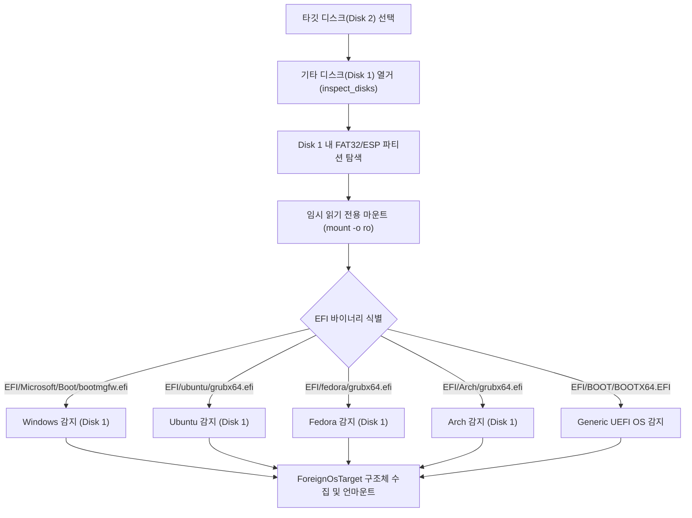

# LiteWin v1.1 다중 디스크(Multi-Disk) 듀얼부팅 아키텍처 및 구현 설계서

## 1. 개요 및 요구사항
- **시나리오**:
  - 시스템에 2개 이상의 디스크가 장착되어 있는 환경
  - **디스크 1 (기존 디스크, 예: `/dev/nvme0n1`)**: 기존 OS(Windows 또는 Linux) 및 데이터가 보존되어 있음.
  - **디스크 2 (타깃 디스크, 예: `/dev/nvme1n1`)**: 사용자가 LiteWin에서 새로 설치할 OS(Windows 11 또는 5대 Linux 중 택일)를 선택하여 설치함.
- **핵심 목표**:
  1. **기존 디스크 1 완전 무손실 (Zero-Destruction Guarantee)**: 디스크 1에는 어떠한 파티션 변경, 포맷, 파일 쓰기도 발생하지 않아야 함(ReadOnly 마운트만 허용). 만약 디스크 2를 분리하더라도 디스크 1은 단독으로 100% 정상 부팅되어야 함.
  2. **디스크 2 기반 자동 듀얼부팅 메뉴 생성**: 디스크 2에 새로 설치되는 OS(Windows든 Linux든)의 부트로더가 디스크 1의 기존 OS를 자동 감지하고 부팅 선택 메뉴에 등록해야 함.
  3. **재부팅 시 선택권 제공**: 전원 인가 시 기본값(디스크 2의 새 OS)으로 5초 대기 후 부팅되되, 방향키 조작으로 디스크 1의 기존 OS로 즉시 전환 부팅할 수 있어야 함.

---

## 2. 기존 OS 자동 탐색 메커니즘 (Foreign OS Discovery Engine)

### 2.1 탐색 단계 (PreCheck ~ MountVolumes)
설치 타깃 디스크(`opts.target_disk_path`)가 결정되면, 파이프라인 시작 시 타깃 디스크를 제외한 호스트의 모든 블록 디바이스를 순회하여 기존 OS를 자동 탐지합니다.



### 2.2 수집 데이터 구조 (`ForeignOsTarget`)
```cpp
struct ForeignOsTarget {
    std::string os_name;         // 예: "Windows 11 (on /dev/nvme0n1p1)"
    std::string disk_path;       // 예: "/dev/nvme0n1"
    std::string esp_device_path; // 예: "/dev/nvme0n1p1"
    std::string esp_uuid;        // 예: "A1B2-C3D4" (blkid로 획득한 고유 파일시스템 UUID)
    std::string efi_loader_path; // 예: "/EFI/Microsoft/Boot/bootmgfw.efi"
};
```

---

## 3. 케이스별 상세 구현 방안

### Case A: 디스크 2에 [리눅스]를 설치하는 경우 (타깃 OS = Linux)

기존 리눅스 배포판들의 `os-prober`는 보안 취약점(CVE-2021-3156 등)으로 인해 최신 GRUB(2.06+)에서 기본값이 `GRUB_DISABLE_OS_PROBER=true`로 비활성화되어 있어 다른 디스크를 자동으로 잡지 못합니다.
따라서 **LiteWin의 결정론적(Deterministic) 네이티브 커스텀 메뉴 생성기**를 적용합니다.

#### 1) 디스크 2의 `/etc/default/grub` 설정 튜닝
- 타깃 루트 파일시스템의 `/etc/default/grub`에 다음을 주입:
  ```ini
  GRUB_TIMEOUT=5
  GRUB_TIMEOUT_STYLE=menu
  GRUB_DISABLE_OS_PROBER=false
  ```

#### 2) `/etc/grub.d/40_custom` 네이티브 체인로더 스크립트 생성
`os-prober`의 불안정한 휴리스틱 탐색에 의존하지 않고, 호스트에서 탐지한 `ForeignOsTarget` 목록을 기반으로 `/etc/grub.d/40_custom`에 영구적인 고유 UUID 체인로더 엔트리를 작성합니다:
```bash
#!/bin/sh
exec tail -n +3 $0

# LiteWin Auto-Generated Foreign OS Dual-Boot Entries
menuentry 'Windows Boot Manager (on /dev/nvme0n1p1)' --class windows --class os $menuentry_id_option 'foreign-windows' {
    insmod part_gpt
    insmod fat
    search --no-floppy --fs-uuid --set=root A1B2-C3D4
    chainloader /EFI/Microsoft/Boot/bootmgfw.efi
}

menuentry 'Previous Linux OS (on /dev/nvme0n1p1)' --class gnu-linux --class os $menuentry_id_option 'foreign-linux' {
    insmod part_gpt
    insmod fat
    search --no-floppy --fs-uuid --set=root C5D6-E7F8
    chainloader /EFI/BOOT/BOOTX64.EFI
}
```
- **장점**:
  - 디스크 이름(`/dev/sda`, `/dev/nvme0n1`)이 재부팅 시 바뀌더라도 파일시스템 고유 UUID(`search --fs-uuid`)로 검색하므로 100% 부팅 보장.
  - 배포판의 패키지 업데이트(`apt update`, `dnf update`)가 수행되어도 `/etc/grub.d/40_custom`은 영구 보존됨.

---

### Case B: 디스크 2에 [윈도우]를 설치하는 경우 (타깃 OS = Windows 11)

Windows 11 설치 시, 마이크로소프트의 기본 `bcdboot`는 타깃 디스크 2의 ESP에만 BCD를 생성하며 다른 디스크의 리눅스나 이전 윈도우를 BCD 부팅 메뉴에 자동으로 등록하지 않습니다.

#### 방안 1: BCD 네이티브 듀얼부팅 엔트리 자동 주입 (권장)
디스크 2의 Windows 배치가 완료된 후, 디스크 2의 ESP(S: 드라이브) BCD 저장소에 디스크 1의 OS 엔트리를 `bcdedit`으로 직접 등록합니다.

1. **디스크 1이 기존 Windows인 경우**:
   ```cmd
   bcdedit /store S:\EFI\Microsoft\Boot\BCD /create /d "Windows 11 (Previous OS on Disk 1)" /application osloader
   bcdedit /store S:\EFI\Microsoft\Boot\BCD /set {new_guid} device partition=HarddiskVolumeX
   bcdedit /store S:\EFI\Microsoft\Boot\BCD /set {new_guid} osdevice partition=HarddiskVolumeX
   bcdedit /store S:\EFI\Microsoft\Boot\BCD /set {new_guid} path \Windows\system32\winload.efi
   bcdedit /store S:\EFI\Microsoft\Boot\BCD /set {bootmgr} displayorder {new_guid} /addlast
   bcdedit /store S:\EFI\Microsoft\Boot\BCD /set {bootmgr} timeout 5
   ```
2. **디스크 1이 기존 Linux인 경우**:
   - 순수 Windows BCD는 타 디스크의 Linux EFI 바이너리를 직접 체인로딩하는 데 제약(디스크 서명 고정 및 서명 검증 이슈)이 있습니다.
   - 따라서 **디스크 2 ESP 최상위에 LiteWin 통합 체인로더(`BOOTX64.EFI`)** 를 배치하거나, **UEFI NVRAM 부팅 순서에 디스크 1과 디스크 2의 부트 엔트리를 모두 등록(`efibootmgr`)** 하여 메인보드 F11/F12 부팅 메뉴에서 언제든지 전환할 수 있도록 합니다.

---

## 4. USB Bootloop Guard의 다중 디스크 핸드오프 개선
현재 `packaging/archiso/grub/grub.cfg`는 다음과 같이 단순하게 1개 디스크만 찾습니다:
```grub
search --file --no-floppy --set=internal_esp /EFI/Litewin/boot_stage.flag
```

이를 개선하여 설치 완료 후 USB가 계속 꽂혀 있더라도 새로 설치된 디스크 2로 우선 부팅되도록 핸드오프 스크립트를 확장합니다:
```grub
# Multi-Disk Auto Handoff
search --file --no-floppy --set=target_esp /EFI/Litewin/target_disk.flag
if [ -n "$target_esp" ]; then
    set default="new-os-handoff"
    set timeout=0
    menuentry "Boot Newly Installed OS" --id 'new-os-handoff' {
        chainloader ($target_esp)/EFI/BOOT/BOOTX64.EFI
        boot
    }
fi
```

---

## 5. 수정 대상 파일 및 세부 구현 로드맵

| 단계 | 작업 내용 | 대상 파일 |
|---|---|---|
| **1단계** | `ForeignOsTarget` 구조체 및 타깃 외 디스크 읽기 전용 ESP 스캐너 구현 | `src/core/disk_inspector.hpp`, `src/core/disk_inspector.cpp` |
| **2단계** | Linux 파이프라인에서 탐색된 OS를 `/etc/grub.d/40_custom`으로 자동 생성 | `src/platform/linux_installer.cpp` |
| **3단계** | Windows 파이프라인에서 디스크 1의 기존 OS BCD 및 NVRAM 이중 등록 | `src/platform/install_pipeline.cpp` |
| **4단계** | USB Bootloop Guard 다중 디스크 핸드오프 지원 | `packaging/archiso/grub/grub.cfg` |
| **5단계** | 다중 디스크 모의 환경 단위 테스트(`mock_dual_disk_tests`) 작성 및 CTest 검증 | `tests/linux_installer_tests.cpp`, `tests/install_pipeline_tests.cpp` |
| **6단계** | 부팅 가능한 최종 v1.1 ISO 도커 재빌드 | `scripts/build_iso_docker.sh` |
