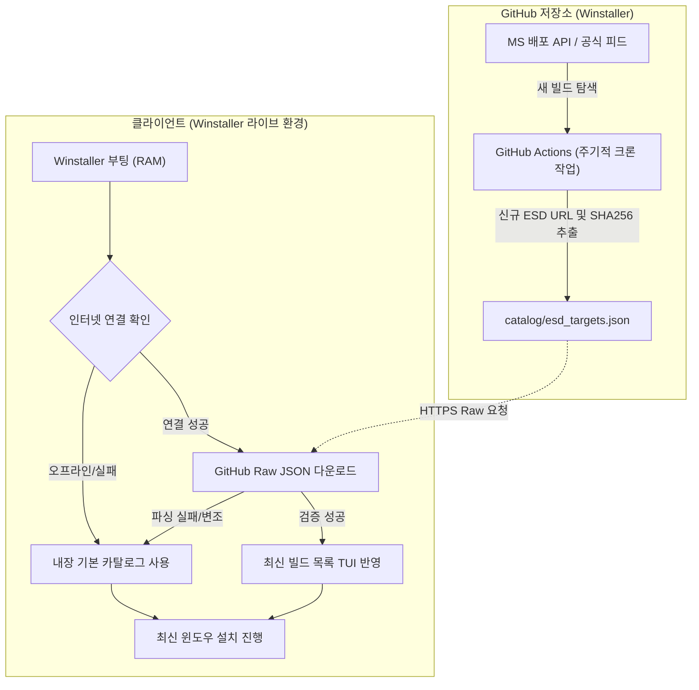

# Winstaller 원격 동적 카탈로그 및 자동 갱신 아키텍처 계획서

본 문서는 Winstaller 부팅 미디어(USB)를 매번 새로 굽지 않고도, 마이크로소프트의 최신 윈도우 정식 빌드 및 ESD 다운로드 정보를 자동으로 반영할 수 있도록 원격 동적 카탈로그 동기화와 GitHub Actions 자동 갱신 시스템을 설계한 계획서입니다.

---

## 1. 시스템 아키텍처 개요



---

## 2. 카탈로그 데이터 규격 (`catalog/esd_targets.json`)

저장소 루트의 `catalog/` 디렉터리에 버전 관리될 표준 JSON 스키마입니다.

```json
{
  "schema_version": "1.0",
  "last_updated": "2026-11-05T00:00:00Z",
  "channel": "Retail/Consumer",
  "targets": [
    {
      "version": "Win11_26H2",
      "display_name": "Windows 11 (26H2 - 26100.1)",
      "language_code": "ko-kr",
      "architecture": "x64",
      "file_name": "26100.1.240331-1435.ge_release_CLIENTCONSUMER_RET_x64FRE_ko-kr.esd",
      "download_url": "http://dl.delivery.mp.microsoft.com/filestreamingservice/files/05215d86-b484-482a-9e12-e56b46ca79d3/26100.1.240331-1435.ge_release_CLIENTCONSUMER_RET_x64FRE_ko-kr.esd",
      "sha256": "9df1b9cf3c75abf13459c03aa55da637651a084c8a8e32c0d80c85b5d15cb981",
      "file_size": 4846430932,
      "default_image_index": 4
    },
    {
      "version": "Win11_26H2",
      "display_name": "Windows 11 (26H2 - 26100.1)",
      "language_code": "en-us",
      "architecture": "x64",
      "file_name": "26100.1.240331-1435.ge_release_CLIENTCONSUMER_RET_x64FRE_en-us.esd",
      "download_url": "http://dl.delivery.mp.microsoft.com/filestreamingservice/files/ffca3922-db15-4fa2-bfeb-ff2f31a4a475/26100.1.240331-1435.ge_release_CLIENTCONSUMER_RET_x64FRE_en-us.esd",
      "sha256": "e78fa71891b988f5747cb988a6d6dca3bb59114f6bdfad2936780c85c3fc6e4e",
      "file_size": 4840487042,
      "default_image_index": 4
    }
  ]
}
```

---

## 3. 클라이언트(Winstaller) 구현 세부 계획

### 3.1 카탈로그 파서 및 관리자 (`src/core/esd_catalog.hpp`)
- `EsdCatalog` 클래스 도입:
  - `load_builtin()`: 기존 C++ 배열(`g_known_targets`)을 기본 상태로 로드.
  - `load_from_json(std::string_view json_text)`: JSON 파서를 통해 유효한 타깃 목록을 파싱하고 메모리에 교체.
  - `find_target(...)`: 런타임 메모리 목록에서 일치하는 최신 타깃 반환.

### 3.2 네트워크 비동기 동기화 (`src/platform/install_pipeline.cpp`)
- TUI 시작 직후 백그라운드 스레드에서 GitHub Raw 엔드포인트 쿼리:
  - 대상 URL: `https://raw.githubusercontent.com/yskyh06/Winstaller/main/catalog/esd_targets.json`
  - 연결 타임아웃: 3초 (설치 화면 진입 시 사용자 대기 시간 최소화)
- 안전장치(Fail-safe):
  - HTTP 200이 아니거나 JSON 구문 오류, 필수 필드(download_url, sha256) 누락 시 즉시 내장 카탈로그로 폴백.
  - 네트워크 단절 상태에서는 로컬 내장 목록으로 지연 없이 즉시 화면 렌더링.

---

## 4. GitHub Actions 자동 갱신 파이프라인

새로운 정식 윈도우 누적 업데이트나 빌드가 배포될 때 자동으로 감지하여 저장소를 업데이트하는 파이프라인입니다.

### 4.1 워크플로 구성 (`.github/workflows/update_catalog.yml`)
- **실행 주기**: 매주 일요일 00:00 UTC (또는 수동 `workflow_dispatch`)
- **주요 단계**:
  1. 저장소 체크아웃
  2. Python/Bash 기반 MS 공식 배포 피드(Mido / UUP dump API) 조회 스크립트 실행
  3. 신규 ESD 파일의 Direct Link 및 공식 SHA-256 해시 추출
  4. 기존 `catalog/esd_targets.json`과 비교하여 변경 사항이 있을 경우 자동 커밋 및 푸시:
     ```bash
     git commit -m "chore(catalog): auto-update windows esd targets [skip ci]"
     git push
     ```

---

## 5. 보안 및 안전장치 (Security & Reliability)

1. **HTTPS 전송 암호화**: GitHub Raw 통신은 TLS 1.3/HTTPS를 통해 이루어지므로 중간자 공격(MITM)에 의한 URL 변조를 원천 차단합니다.
2. **해시 검증 필수 정책**: 다운로드 URL뿐만 아니라 마이크로소프트의 공식 SHA-256 해시가 함께 포함되어 있으며, 클라이언트 다운로드 시 인플라이트 해시 검증을 반드시 거칩니다.
3. **완전한 무중단 오프라인 호환**: 인터넷 연결이 원활하지 않거나 GitHub 서버 장애 시에도 기존 내장 목록을 통해 100% 정상 설치가 가능합니다.
