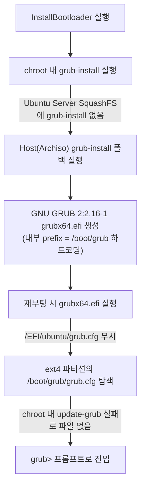
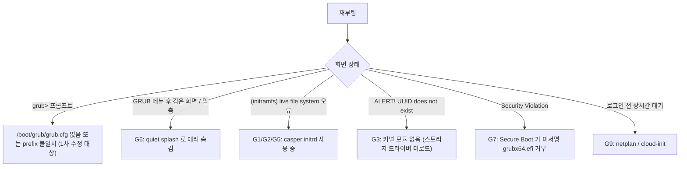

# Ubuntu Server CLI 설치 후 `GNU GRUB version 2:2.16-1` (`grub>`) 부팅 실패 원인 분석 및 해결 방안

## 1. 증상 요약
Ubuntu 26.04 LTS (Server CLI) 설치 완료 후 재부팅 시 Ubuntu 커널로 진입하지 못하고 아래와 같은 GRUB 쉘 프롬프트에서 멈춤:

```text
GNU GRUB version 2:2.16-1

Minimal BASH-like line editing is supported. For the first word, TAB
lists possible command completions. Anywhere else TAB lists possible
device or file completions. To enable less(1) -like paging, "set
pager=1".

grub>
```

---

## 2. 핵심 원인 분석 (3가지 복합 원인)

### 원인 ① 왜 우분투 GRUB이 아닌 `GNU GRUB version 2:2.16-1`이 떴는가?
- **`2:2.16-1`은 LiteWin 라이브 환경(Arch Linux)의 GRUB 패키지 버전**입니다.
- Ubuntu Live Server CLI ISO의 SquashFS 레이어(`ubuntu-server-minimal.squashfs` + `ubuntu-server-minimal.ubuntu-server.squashfs`) 내부에는 `grub-efi-amd64-bin`(`grub-install` 명령어)이 기본 포함되어 있지 않습니다. (Ubuntu 공식 Subiquity 설치기는 ISO 내의 서명된 `.efi` 바이너리나 APT 풀 패키지를 별도로 설치함)
- 따라서 [`LinuxInstaller::execute()`](file:///home/yskyh06/linux-workspace/litewin/src/platform/linux_installer.cpp#L1079-L1116)의 `InstallBootloader` 단계에서 `chroot /mnt/litewin_linux grub-install ...`이 실패하고, **LiteWin 호스트(Archiso)의 `grub-install` 폴백(Fallback)**이 실행되어 Arch Linux의 `grubx64.efi`(`GNU GRUB version 2:2.16-1`)가 `/boot/efi/EFI/ubuntu/grubx64.efi` 및 `/boot/efi/EFI/BOOT/BOOTX64.EFI`에 설치되었습니다.

### 원인 ② 왜 `/EFI/ubuntu/grub.cfg` 스텁을 무시하고 `grub>` 쉘로 빠졌는가?
- Ubuntu의 사전 빌드된 서명 바이너리(`grubx64.efi.signed`)는 같은 EFI 파티션 디렉토리의 `/EFI/ubuntu/grub.cfg`를 먼저 읽지만, **`grub-install`이 생성한 `grubx64.efi` 바이너리는 내부에 `prefix=(hdX,gpt2)/boot/grub`가 하드코딩**되어 빌드됩니다.
- 즉, `grub-install`로 설치된 `GNU GRUB 2:2.16-1`은 EFI 파티션의 `/EFI/ubuntu/grub.cfg`를 **전혀 읽지 않고**, 곧바로 ext4 루트 파티션의 **`/boot/grub/grub.cfg`만 탐색**합니다.
- 그러나 Ubuntu Server Minimal chroot 내부에는 `update-grub` / `grub-mkconfig`가 없거나 실행에 실패하여 **ext4 루트 파티션의 `/boot/grub/grub.cfg` 파일 자체가 생성되지 않았고**, 설정 파일을 찾지 못한 GRUB이 즉시 `grub>` 복구 프롬프트로 떨어진 것입니다.

### 원인 ③ `/boot` 내 커널/Initrd 실제 파일명과 `grub.cfg` 간 불일치
- [`ExtractRootFS`](file:///home/yskyh06/linux-workspace/litewin/src/platform/linux_installer.cpp#L825-L853) 단계에서 ISO의 커널과 initrd를 복사할 때 `/lib/modules/<kver>` 디렉토리명을 감지하여 `/boot/vmlinuz-<kver>` 및 `/boot/initrd.img-<kver>`(예: `vmlinuz-6.14.0-15-generic`)로 저장합니다.
- 반면 기존 [`build_forwarding_grub_cfg()`](file:///home/yskyh06/linux-workspace/litewin/src/platform/linux_installer.cpp#L176-L221)의 폴백 엔트리는 `/boot/vmlinuz-generic`으로만 고정되어 있어, 실제 `<kver>` 파일명이나 `/boot/vmlinuz` 심볼릭 링크가 없으면 커널 로드에 실패합니다.



---

## 3. 구체적 해결 방안 (수정 계획)

| 단계 | 수정 위치 | 상세 구현 내용 |
| :--- | :--- | :--- |
| **1. 커널/Initrd 표준 심볼릭 링크 및 동적 파일명 탐지** | [`src/platform/linux_installer.cpp`](file:///home/yskyh06/linux-workspace/litewin/src/platform/linux_installer.cpp) (`ExtractRootFS` & `InstallBootloader`) | `/boot/vmlinuz-<kver>`, `/boot/initrd.img-<kver>` 복사 시 `/boot/vmlinuz`, `/boot/initrd.img` 및 `/boot/vmlinuz-generic`, `/boot/initrd.img-generic`을 보장하여 어떤 GRUB 엔트리에서도 100% 커널을 찾도록 보장 |
| **2. `/boot/grub/grub.cfg` 직접 생성 보장 (`build_main_grub_cfg`)** | [`src/platform/linux_installer.hpp`](file:///home/yskyh06/linux-workspace/litewin/src/platform/linux_installer.hpp), [`src/platform/linux_installer.cpp`](file:///home/yskyh06/linux-workspace/litewin/src/platform/linux_installer.cpp) | `chroot ... update-grub` 실행 후 `/boot/grub/grub.cfg`가 없거나 유효한 `menuentry`가 없으면, C++에서 직접 루트 UUID(`root=UUID=<uuid> ro`), 실제 커널/initrd 경로, 듀얼부팅(`foreign_os`) 엔트리를 포함한 완전한 `/boot/grub/grub.cfg`를 생성 |
| **3. EFI 스텁과 메인 `grub.cfg` 양방향 동기화** | [`src/platform/linux_installer.cpp`](file:///home/yskyh06/linux-workspace/litewin/src/platform/linux_installer.cpp) (`InstallBootloader`) | `/boot/grub/grub.cfg`(메인 설정)와 `/boot/efi/EFI/ubuntu/grub.cfg`, `/boot/efi/EFI/BOOT/grub.cfg`(EFI 스텁 + 직접 커널 부트 폴백)를 모두 실제 커널 경로로 생성하여, Archiso `grubx64.efi`든 Ubuntu 서명 `grubx64.efi`든 100% Ubuntu로 직행 부팅되도록 구성 |
| **4. 단위 테스트 검증** | [`tests/linux_installer_tests.cpp`](file:///home/yskyh06/linux-workspace/litewin/tests/linux_installer_tests.cpp) | `build_main_grub_cfg()` 및 `build_forwarding_grub_cfg()`가 실제 커널 파일명과 UUID, 듀얼부팅 엔트리를 정확히 생성하는지 검증 |


---

## 4. [추가] 1차 수정(`build_main_grub_cfg`) 이후에도 남아 있는 예상 오류 및 버그

> [!IMPORTANT]
> 1차 수정으로 "`/boot/grub/grub.cfg` 없음 → `grub>`" 문제는 해결되지만, **GRUB 단계를 통과한 뒤 커널/initramfs/rootfs 단계에서 다시 멈출 가능성이 높습니다.** 핵심 원인은 **Ubuntu Live Server의 SquashFS 레이어는 "설치 대상 rootfs"가 아니라 "Subiquity 설치기가 APT로 커널·GRUB을 추가 설치하기 전의 베이스"**라는 점입니다.

### 4.1. 예상 버그 목록

| ID | 단계 | 예상 증상 | 근본 원인 (현재 코드 기준) | 치명도 |
| :--- | :--- | :--- | :--- | :---: |
| **G1** | 커널 부팅 직후 | `(initramfs) Unable to find a medium containing a live file system` 후 BusyBox 셸 | [`ExtractRootFS`](file:///home/yskyh06/linux-workspace/litewin/src/platform/linux_installer.cpp#L974-L1036)가 ISO의 **`/casper/initrd`(라이브 부팅 전용 casper initrd)**를 `/boot/initrd.img-<kver>`로 복사함. 이 initrd는 디스크의 ext4 루트가 아니라 CD/USB의 `filesystem.squashfs`를 찾음 | **Critical** |
| **G2** | ConfigureChroot | G1의 casper initrd가 교체되지 않고 그대로 남음 | [`build_chroot_commands`](file:///home/yskyh06/linux-workspace/litewin/src/platform/linux_installer.cpp#L258)의 `update-initramfs -u -k all \|\| update-initramfs -c -k all`: `-u`는 `/var/lib/initramfs-tools/<kver>` 상태 파일이 없으면 **아무것도 하지 않고 성공(0)을 반환**할 수 있어 `-c` 폴백이 실행되지 않음. 끝에 `\|\| true`가 있어 실패도 감지 불가 | **Critical** |
| **G3** | 커널 부팅 / 드라이버 | `/lib/modules/<kver>` 없음 → NVMe·virtio·AHCI 모듈 로드 실패, `ALERT! UUID=... does not exist` | 서버 rootfs 레이어(`ubuntu-server-minimal` + `.ubuntu-server`)에는 **`linux-image-generic`/`linux-modules-*` 패키지가 없음**(커널 레이어는 `...installer.generic.squashfs` 등 설치기 전용). 현재 코드는 `stem + ".generic.squashfs"`만 탐색하므로 실제 파일명과 불일치 시 커널 모듈이 전혀 추출되지 않음 → `kver="generic"`으로 떨어짐 | **Critical** |
| **G4** | InstallBootloader | `chroot grub-install` 항상 실패 → Arch GRUB(2:2.16-1) 폴백 고정 | G3와 동일 원인: `grub-efi-amd64-bin`, `grub-efi-amd64-signed`, `shim-signed` 미설치. Ubuntu `update-grub`도 없거나 `grub-probe` 실패 | High |
| **G5** | GRUB 메뉴 | Ubuntu `update-grub`가 **성공한 경우** 생성된 `grub.cfg`가 유효성 검사(`menuentry` + `vmlinuz` 포함)를 통과하여 LiteWin 생성본으로 교체되지 않음 → G1의 casper initrd를 그대로 참조 | [`InstallBootloader`](file:///home/yskyh06/linux-workspace/litewin/src/platform/linux_installer.cpp#L1288-L1303) 유효성 검사가 "문자열 존재"만 확인하고 **initrd 내용(casper 여부)은 검증하지 않음** | High |
| **G6** | GRUB 메뉴 | 화면이 멈춘 것처럼 보이고 메뉴/에러가 안 보임 | [`build_grub_default_config`](file:///home/yskyh06/linux-workspace/litewin/src/platform/linux_installer.cpp#L287-L301): 단일 부팅 시 `GRUB_TIMEOUT=0`, `GRUB_TIMEOUT_STYLE=hidden`, `quiet splash` → 실패 원인을 사용자가 볼 수 없음 | Medium |
| **G7** | UEFI 펌웨어 | `Security Violation` / 부팅 항목 건너뜀 | Arch `grub-install` 산출물은 **서명되지 않은 `grubx64.efi`** → Secure Boot가 켜진 PC·Hyper-V Gen2·OVMF(SB) 환경에서 실행 거부 | Medium |
| **G8** | GRUB `search` | 다른 디스크(또는 USB)의 `ROOT` 라벨 파티션으로 잘못 부팅 | 폴백 경로가 `search --label --set=root ROOT` 및 `(hd0,gpt2)` 하드코딩 사용. 멀티디스크에서 `hd0`가 설치 대상이 아닐 수 있음 | Medium |
| **G9** | 부팅 후 systemd | 로그인 전 1~2분 지연(`A start job is running for Wait for Network to be Configured`), 네트워크 없음 | Subiquity가 작성하는 **netplan 설정 미생성** + Server 이미지의 `cloud-init`이 데이터소스를 탐색하며 대기 | Low |
| **G10** | 테스트 | 단위 테스트 89/89 통과에도 실기기 부팅 실패 | [`tests/linux_installer_tests.cpp`](file:///home/yskyh06/linux-workspace/litewin/tests/linux_installer_tests.cpp)는 **dry-run 경로만 검증**. 실제 경로(커널 탐지, 심볼릭 링크, `grub.cfg` 유효성 검사)는 테스트되지 않음 | Medium |

### 4.2. 증상별 원인 판별 흐름



### 4.3. 사용자 측 즉시 확인 방법 (`grub>` 프롬프트에서 실행)

```grub
ls (hd0,gpt2)/boot/
ls (hd0,gpt2)/lib/modules/
cat (hd0,gpt2)/boot/grub/grub.cfg
```

| 결과 | 판정 |
| :--- | :--- |
| `/lib/modules/` 가 비어 있음 또는 `error: file not found` | **G3 확정** — 커널 패키지가 rootfs에 없음 |
| `/boot/`에 `vmlinuz-generic`, `initrd.img-generic`만 존재 | G3 + G1 — ISO의 casper 커널/initrd를 그대로 사용 중 |
| `grub.cfg` 내 `initrd` 경로가 casper 원본 | G5 |

수동 부팅 테스트(`quiet` 제거로 에러 노출):
```grub
set root=(hd0,gpt2)
linux /boot/vmlinuz-generic root=/dev/sda2 ro
initrd /boot/initrd.img-generic
boot
```

### 4.4. 근본 해결 방안 (2차 수정 계획)

1. **커널 패키지 확보 (G3·G4 해결)** — [`linux_installer.cpp`](file:///home/yskyh06/linux-workspace/litewin/src/platform/linux_installer.cpp) `AcquireImage`
   - ISO의 `casper/*.squashfs` 전체 목록을 스캔하여 `*.generic.squashfs` / `*installer.generic*.squashfs` 등 **커널 레이어를 이름 패턴으로 탐지**하고, 그 레이어에서 `/lib/modules/<kver>`와 `/boot/vmlinuz-<kver>`만 선택 추출.
   - 또는 ISO의 APT 풀(`/pool/main/l/linux-*`, `/pool/main/g/grub2-signed`, `/pool/main/s/shim-signed`)을 chroot에 `file:` 저장소로 마운트하여 `apt-get install --no-download linux-generic grub-efi-amd64-signed shim-signed` 실행 (Subiquity와 동일한 방식).
2. **디스크용 initramfs 강제 재생성 (G1·G2 해결)** — `build_chroot_commands`
   - casper initrd를 복사하지 않거나, 복사 후 반드시 삭제하고 `for k in /lib/modules/*; do update-initramfs -c -k "$(basename "$k")"; done` 실행. 실패 시 `|| true`로 무시하지 말고 **ConfigureChroot 실패로 보고**.
   - 생성 후 `lsinitramfs`로 `scripts/casper` 포함 여부를 검사하여 casper initrd면 실패 처리.
3. **`grub.cfg` 유효성 검사 강화 (G5)** — `menuentry` 문자열뿐 아니라 참조된 `linux`/`initrd` 파일이 실제 존재하고 casper initrd가 아닌지 검사.
4. **디버깅 가능성 확보 (G6)** — 단일 부팅도 `GRUB_TIMEOUT=3`, `GRUB_TIMEOUT_STYLE=menu`; 기본 cmdline에서 `quiet splash` 제거 또는 별도 "Recovery (verbose)" 엔트리 추가.
5. **Secure Boot 대응 (G7)** — 서명된 `shimx64.efi` + `grubx64.efi.signed`를 ISO(`/EFI/boot/`)에서 복사하여 우선 사용, Arch GRUB 폴백 시 TUI에 "Secure Boot 비활성화 필요" 경고 표시.
6. **루트 탐색 고정 (G8)** — `(hd0,gpt2)` / `LABEL=ROOT` 폴백 제거, 항상 `root=UUID=<uuid>` 및 `search --fs-uuid` 사용.
7. **서버 후처리 (G9)** — `/etc/netplan/01-litewin.yaml`(DHCP 전체 이더넷) 생성, `touch /etc/cloud/cloud-init.disabled`.
8. **실경로 테스트 추가 (G10)** — 임시 디렉터리에 가짜 `/boot`·`/lib/modules` 트리를 만들어 커널 탐지·`grub.cfg` 생성 함수를 non-dry-run으로 검증.


### 4.5. 실측 결과 (2026-11-08, 사용자 `grub>` 확인)

```text
/boot: System.map-7.0.0-14-generic config-7.0.0-14-generic grub/ initrd.img initrd.img.old
       vmlinuz vmlinuz-7.0.0-14-generic vmlinuz.old initrd.img-7.0.0-14-generic efi/
/lib/modules: 7.0.0-14-generic/
```

| 가설 | 판정 | 근거 |
| :--- | :--- | :--- |
| G3 (커널 모듈 없음) | **기각** | `/lib/modules/7.0.0-14-generic/` 존재 |
| G1 (casper 커널 사용) | **가능성 낮음** | `System.map-*`, `config-*`, `vmlinuz.old` 존재 → `linux-image` 패키지가 정상 설치된 rootfs. casper 복사 코드는 기존 파일이 있으면 덮어쓰지 않음 |
| G4 (chroot `grub-install` 실패) | 유지 | `GNU GRUB 2:2.16-1`(Arch) 표시 |
| 1차 원인 (`/boot/grub/grub.cfg` 없음) | **유력** | 여전히 `grub>` 진입. `vmlinuz-generic` 심볼릭 링크가 없음 → 1차 수정 **이전 ISO로 설치된 디스크**로 판단 |
| G1-b (initrd가 casper용인지) | 미확인 | 수동 부팅으로 확인 필요 |


### 4.6. 실측 결과 2 — G1/G2 확정 (casper initrd 사용)

수동 부팅(`linux /boot/vmlinuz-7.0.0-14-generic root=UUID=$u ro` + `initrd /boot/initrd.img-7.0.0-14-generic`) 결과:
- 커널 부팅 성공 후 `stdin: Invalid argument` 반복 출력, `Ctrl+C` 후 `Unable to find a medium containing a live file system`.
- **판정: G1/G2 확정.** `/boot/initrd.img-7.0.0-14-generic`는 casper(라이브 부팅) 스크립트가 들어간 initramfs이고, `stdin: Invalid argument` 반복은 casper가 라이브 미디어를 찾으며 반복 시도하는 출력임.

**추정 경위**
1. Live Server SquashFS 안의 `/boot/initrd.img-<kver>` 자체가 casper 훅이 포함된 상태로 빌드됨 (ISO의 `/casper/initrd`와 동일 계열).
2. casper 패키지가 남아 있으면 `/usr/share/initramfs-tools/conf.d/default-boot-to-casper.conf`(`BOOT=casper`)와 `scripts/casper`가 남아, `update-initramfs`를 다시 돌려도 casper initrd가 재생성됨.
3. `apt-get purge ... casper || true`, `update-initramfs -u ... || true`가 실패/무동작해도 `|| true`로 묻혀 감지되지 않음.

**코드 수정 방향 (Debian 계열 `build_chroot_commands`)**
- `dpkg --purge --force-depends casper` 후 `rm -f /usr/share/initramfs-tools/conf.d/default-boot-to-casper.conf /etc/initramfs-tools/conf.d/*casper*`.
- 기존 initrd 삭제 후 `/lib/modules/*` 각 버전에 대해 `update-initramfs -c -k <kver>` 실행, 실패 시 ConfigureChroot 실패로 보고.
- 생성 후 `lsinitramfs /boot/initrd.img-<kver> | grep -q scripts/casper`이면 실패 처리.


**임시 우회 방법 (검증 전)** — casper의 `BOOT=casper` 기본값을 커널 인자로 덮어써 디스크로 부팅:
```grub
set root=(hd0,gpt2)
probe --fs-uuid --set=u (hd0,gpt2)
linux /boot/vmlinuz-7.0.0-14-generic root=UUID=$u ro boot=local
initrd /boot/initrd.img-7.0.0-14-generic
boot
```
부팅 성공 시 설치된 시스템에서 복구:
```bash
sudo dpkg --purge --force-depends casper
sudo rm -f /usr/share/initramfs-tools/conf.d/default-boot-to-casper.conf
sudo update-initramfs -c -k 7.0.0-14-generic
sudo update-grub
```

> [!NOTE]
> 수동 부팅 중 `VFS: Unable to mount root fs on unknown-block(0,0)`이 한 차례 발생했으나, 명령 입력 오타로 initrd가 로드되지 않은 것이며 설치기 버그가 아님.


---

### 4.7. 실측 결과 3 — GRUB에서 CD(LiteWin ISO) 디바이스가 선택되어 재설치 화면으로 진입한 현상 분석 및 개선안

#### 1) 원인 분석
1. **하이브리드 GPT ISO 구조로 인한 `(hd0)` / CD 디바이스 혼동**:
   - `litewin-2026.11-x86_64.iso`는 내부에 GPT 파티션 테이블(`gpt1`: `LITEWIN_LIVE`, `gpt2`: `ARCHISO_EFI`, `gpt3`)을 가진 하이브리드 ISO 이미지입니다.
   - VM/PC에 ISO(CD/USB)가 마운트된 상태에서는 펌웨어에 따라 CD/USB가 `(hd0)` 또는 기본 부트 디바이스로 잡히며, GRUB 메뉴에서 기본 항목(`Winstaller`)이나 CD 쪽 파티션이 선택되면 내장 디스크의 우분투가 아니라 **CD 안의 LiteWin 설치 환경(`archisolabel=LITEWIN_LIVE`)으로 부팅되어 2.7GB 다운로드(재설치)**가 시작됩니다.
2. **CD의 GRUB 메뉴에서 내장 디스크 우분투로 넘기는 핸드오프(`ubuntu-handoff`)의 한계**:
   - 기존 [`packaging/archiso/grub/grub.cfg`](file:///home/yskyh06/linux-workspace/litewin/packaging/archiso/grub/grub.cfg)의 내장 디스크 부팅 항목은 `/EFI/Litewin/boot_stage.flag`가 있을 때만 표시되고, `configfile`로만 점프했습니다.
   - 만약 기존에 설치된 디스크에 `/boot/grub/grub.cfg`가 없거나 깨져 있으면 `configfile`이 실패하여 부팅하지 못합니다.

#### 2) 해결 방안 (`packaging/archiso/grub/grub.cfg` 및 설치기 보완)
1. **CD/USB 부팅 메뉴(`Winstaller`)와 내장 디스크 부팅 메뉴(`Boot Installed Ubuntu from Internal Disk`)의 명확한 표기 및 분리**:
   - ISO로 부팅했을 때 메뉴 이름을 `[Live ISO / Reinstall] Winstaller - OS Installer`와 `[Internal Disk] Boot Installed Ubuntu Linux`로 명확히 구분하여 실수로 CD(재설치)로 진입하는 일을 방지합니다.
2. **`boot_stage.flag` 유무와 무관하게 `ROOT` 파티션(`/boot/vmlinuz`) 탐지 시 내장 디스크 직접 부팅(Direct Kernel Boot) 지원**:
   - [`packaging/archiso/grub/grub.cfg`](file:///home/yskyh06/linux-workspace/litewin/packaging/archiso/grub/grub.cfg)에서 `search --no-floppy --label --set=linux_root ROOT`로 내장 디스크의 `ROOT` 파티션을 찾으면:
     - `($linux_root)/boot/grub/grub.cfg`가 있을 때는 해당 설정 파일을 로드하고,
     - `grub.cfg`가 없는 기존 설치 디스크라도 **`($linux_root)/boot/vmlinuz`와 `($linux_root)/boot/initrd.img`에 `root=UUID=$root_uuid ro boot=local`을 붙여 GRUB에서 즉시 직접 부팅**할 수 있는 메뉴 엔트리를 제공합니다.
