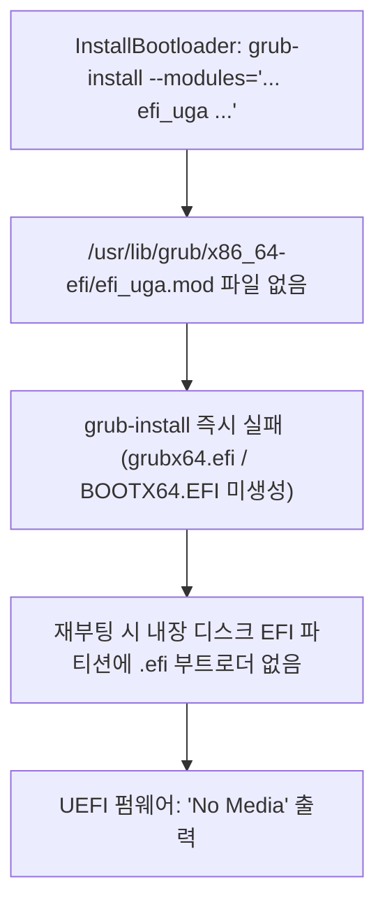

# Ubuntu 부팅 후 로그인 실패 및 단독 부팅 시 `No Media` 오류 원인 분석·수정 계획

## 1. 증상 요약
1. **증상 ① (`No Media` 및 ISO 경유 부팅 현상)**:
   - 설치 완료 후 재부팅 시 하드디스크 단독으로는 `No Media`가 뜨며 부팅되지 않고, LiteWin ISO로 부팅한 뒤 `[Internal Disk] Boot Installed Ubuntu / Linux (Direct Boot)`를 선택해야 우분투(`login:` 화면)로 부팅됨.
2. **증상 ② (우분투 `login:` 화면에서 아이디/비밀번호 로그인 실패)**:
   - 우분투 CLI 로그인 프롬프트(`login:`)까지는 정상 진입했으나, 아이디와 비밀번호를 입력하면 `Login incorrect`가 발생함.

---

## 2. 핵심 원인 분석

### 2.1. 왜 하드디스크 단독 부팅 시 `No Media`가 뜨고 ISO를 거쳐야만 부팅되었는가?
- **원인: [`src/platform/linux_installer.cpp`](file:///home/yskyh06/linux-workspace/litewin/src/platform/linux_installer.cpp#L1230-L1254)의 `grub-install` 실행 시 존재하지 않는 `efi_uga` 모듈 지정으로 인한 `.efi` 생성 실패**
  - 직전 수정에서 호스트 `grub-install` 호출 시 `--modules="... efi_uga ..."` 옵션을 추가했습니다.
  - 그러나 최신 Arch Linux의 64비트 UEFI GRUB(`2:2.16-1`, `/usr/lib/grub/x86_64-efi/`)에는 레거시 모듈인 **`efi_uga.mod` 파일이 존재하지 않습니다.**
  - `grub-install`(`grub-mkimage`)은 `--modules` 목록 중 단 하나의 모듈이라도 없으면 `cannot open '/usr/lib/grub/x86_64-efi/efi_uga.mod': No such file or directory` 오류를 내며 **즉시 중단되고, `/boot/efi/EFI/ubuntu/grubx64.efi`와 `/boot/efi/EFI/BOOT/BOOTX64.EFI` 파일을 아예 생성하지 않습니다.**
  - 그 결과 내장 디스크의 EFI 파티션(`/dev/sda1`)이 비어 있게 되어 UEFI 펌웨어가 부팅 가능한 `.efi` 파일을 찾지 못하고 **`No Media`**를 출력한 것입니다.
  - 반면 ISO의 `[Internal Disk] Boot Installed Ubuntu (Direct Boot)` 메뉴는 ISO의 GRUB이 내장 디스크 2번 파티션(`ROOT`)의 `/boot/vmlinuz`와 `/boot/initrd.img`를 `boot=local`로 직접 로드했기 때문에 정상 부팅된 것입니다. (즉, 커널 및 initramfs의 `boot=local` 수정 자체는 완벽히 성공함)

---

### 2.2. 왜 `login:` 프롬프트에서 유저 이름과 비밀번호가 틀리다고 나오는가?
3가지 원인이 중첩되어 발생했습니다:

1. **원인 ① 설치 시작 시점(`lopts` 스냅샷)과 진행 중 TUI 입력 간의 시점 불일치 ([`src/main.cpp`](file:///home/yskyh06/linux-workspace/litewin/src/main.cpp#L382-L423))**:
   - 현재 TUI는 `Wi-Fi` → `OS 선택` → `디스크 선택` 직후 **아이디/비밀번호를 먼저 입력받지 않고 즉시 `LinuxInstaller::execute(lopts)`를 시작**합니다.
   - 이때 `lopts.username = "user"`, `lopts.password = ""`(빈 문자열) 상태로 고정되어 `ConfigureChroot`가 실행됩니다.
2. **원인 ② 설치 완료 후 실행되는 [`update_installed_user_credentials()`](file:///home/yskyh06/linux-workspace/litewin/src/platform/linux_installer.cpp#L582-L642)에서 `/dev`, `/proc` 미마운트로 인한 `chpasswd` 실패**:
   - 사용자가 설치 도중이나 완료 후 TUI 우측 패널에서 아이디/비밀번호를 입력하면, `UnmountVolumes`로 `/dev`와 `/proc`가 언마운트된 뒤에 `update_installed_user_credentials()`가 호출됩니다.
   - `update_installed_user_credentials()`는 ext4 루트 파티션만 마운트하고 **`/dev`(`urandom`, `null`)와 `/proc`를 마운트하지 않은 채 `chroot ... chpasswd`를 실행**합니다.
   - Ubuntu 24.04/26.04의 `chpasswd`(`libxcrypt` yescrypt 해시 생성)는 솔트(Salt) 생성을 위해 `/dev/urandom`이 필수이므로, **`/dev/urandom`이 없는 chroot에서 `chpasswd`가 실패하여 비밀번호가 전혀 저장되지 않습니다.**
3. **원인 ③ 비밀번호를 비워두었을 때 Ubuntu PAM(`pam_unix.so`)의 빈 비밀번호 로그인 거부**:
   - 비밀번호를 입력하지 않아 `passwd -d`(빈 비밀번호)로 설정된 경우, Ubuntu Server의 `/etc/pam.d/common-auth`에는 기본적으로 `nullok` 옵션이 없어 콘솔 `login:`에서 빈 비밀번호 엔터 입력을 무조건 `Login incorrect`로 거부합니다.

---

## 3. 구체적 해결 방안 (수정 계획)

| 구분 | 수정 파일 | 상세 구현 내용 |
| :--- | :--- | :--- |
| **1. `No Media` 해결: `grub-install` 오류 제거 및 `grub-mkstandalone` 이중 보장** | [`src/platform/linux_installer.cpp`](file:///home/yskyh06/linux-workspace/litewin/src/platform/linux_installer.cpp) (`InstallBootloader`) | • `grub-install` 호출 시 실패를 유발한 `--modules=...`(`efi_uga`) 인자를 제거하여 기본 모듈 전체 복사 및 `grubx64.efi`/`BOOTX64.EFI` 생성이 100% 성공하도록 복원합니다. (이전 빌드에서 `GNU GRUB 2:2.16-1` 부팅이 동작했던 검증된 방식) • 만약 `grub-install` 후에도 `grubx64.efi`가 없다면 `grub-mkstandalone -O x86_64-efi -o .../grubx64.efi "boot/grub/grub.cfg=..."`로 독립형 `.efi` 바이너리를 직접 생성하고 `BOOTX64.EFI`에도 복사하여 `No Media` 발생을 원천 차단합니다. |
| **2. 리눅스 선택 시 설치 시작 전 유저 이름·비밀번호 강제 설정 단계 추가** | [`src/ui/winstaller_tui.hpp`](file:///home/yskyh06/linux-workspace/litewin/src/ui/winstaller_tui.hpp), [`src/ui/winstaller_tui.cpp`](file:///home/yskyh06/linux-workspace/litewin/src/ui/winstaller_tui.cpp), [`src/main.cpp`](file:///home/yskyh06/linux-workspace/litewin/src/main.cpp) | • 디스크 선택 직후(설치 파이프라인 시작 전) **계정 설정(Username / Password)을 먼저 확정**하도록 강제합니다. • 특히 리눅스 설치 시에는 소문자 아이디(예: 기본값 `user` 또는 사용자 입력)와 **비어 있지 않은 비밀번호(두 번 일치 확인)**를 반드시 입력해야 설치가 시작되도록 검증하여, `ConfigureChroot` 단계에서부터 정확한 아이디/비밀번호가 적용되게 합니다. |
| **3. 비밀번호 해시 적용 신뢰성 100% 보장 (`ConfigureChroot` & `update_installed_user_credentials`)** | [`src/platform/linux_installer.cpp`](file:///home/yskyh06/linux-workspace/litewin/src/platform/linux_installer.cpp) | • `ConfigureChroot`에서 `useradd -m -s /bin/bash <user>` 후 `passwd -u <user>` 및 `echo '<user>:<pass>' \| chpasswd`와 함께 `root` 계정에도 동일 비밀번호를 설정하고, `/etc/pam.d/common-auth`에 `nullok`도 허용합니다. • `update_installed_user_credentials()` 실행 시에도 반드시 `/dev`와 `/proc`를 바인드 마운트한 상태에서 `chpasswd`를 실행하고 언마운트하도록 수정합니다. |
