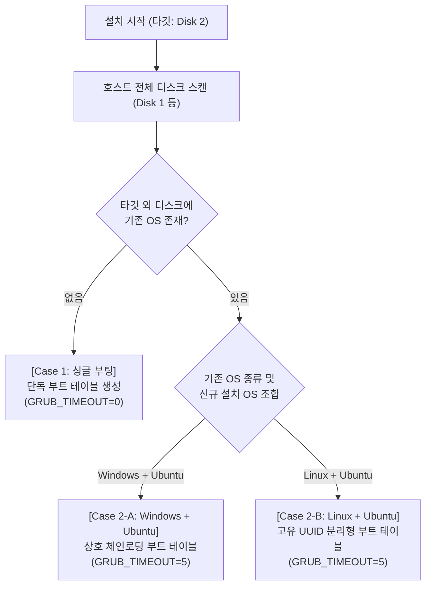

# LiteWin v1.1 Ubuntu 부트 테이블 생성 및 싱글/듀얼부팅 전체 설계 검토서

## 1. 개요 (Overview)
리눅스 지원 범위를 **Ubuntu (18.04 ~ 26.04 LTS, Desktop & Server)** 중심으로 집중함에 따라, 현재 코드베이스(`src/platform/linux_installer.cpp`, `src/platform/winpe_bootstrapper.cpp`, `packaging/archiso/grub/grub.cfg`)의 부트 테이블 생성 과정을 전수 조사하고 **싱글부팅** 및 **다중 디스크 듀얼부팅(Windows+Ubuntu, Linux+Ubuntu)** 케이스별 완벽한 부트 설정 아키텍처를 정의합니다.

---

## 2. 현재 Ubuntu 부트 설정 코드 전수 검토 결과 (5대 치명적 원인)

현재 [src/platform/linux_installer.cpp](file:///home/yskyh06/linux-workspace/litewin/src/platform/linux_installer.cpp)를 정밀 분석한 결과, 설치 완료 후 부팅이 되지 않거나 BIOS 부트 테이블에 잡히지 않는 **5가지 결정적 원인**을 확인했습니다.

### 🚨 원인 1: `MountVolumes` 순서 오류로 인한 `/dev` 캐릭터 디바이스 삭제 버그
- **현재 코드 ([src/platform/linux_installer.cpp](file:///home/yskyh06/linux-workspace/litewin/src/platform/linux_installer.cpp#L443-L467), [#L175](file:///home/yskyh06/linux-workspace/litewin/src/platform/linux_installer.cpp#L175))**:
  - 3단계(`MountVolumes`)에서 호스트의 `/dev`, `/proc`, `/sys`를 타깃에 먼저 `--rbind` 마운트합니다.
  - 이후 5단계(`ExtractRootFS`)에서 Ubuntu 24.04/26.04(`LayeredSquashFS`) 추출 후 OverlayFS 화이트아웃 제거를 위해 다음 명령을 실행합니다:
    ```bash
    find '/mnt/litewin_linux' -type c -size 0 -delete
    ```
- **문제점**:
  - 리눅스의 모든 캐릭터 디바이스(`/dev/null`, `/dev/zero`, `/dev/urandom`, `/dev/tty`, `/dev/console`)는 **`-type c`이면서 파일 크기가 `0` (`-size 0`)** 입니다!
  - `/dev`가 `--rbind`된 상태에서 위 `find -delete`가 실행되면서 **호스트와 타깃의 `/dev/null`, `/dev/urandom`, `/dev/console`이 통째로 삭제**되어 이후 실행되는 `chroot`, `update-initramfs`, `grub-install`, `update-grub`이 정상 동작하지 못합니다.
- **해결**:
  - `MountVolumes`에서는 오직 물리 디스크 파티션(`/` 및 `/boot/efi`)만 마운트하고, 가상 파일시스템(`/dev`, `/proc`, `/sys`, `/run`, `efivarfs`)은 반드시 **5단계(`ExtractRootFS`)가 끝난 직후(6단계 `ConfigureChroot` 직전)** 에 마운트해야 합니다.
  - 화이트아웃 정리 명령도 `/dev`, `/proc`, `/sys`를 명시적으로 제외하고 major/minor 번호가 `0:0`인 파일만 제거하거나 `ExtractRootFS` 단계(가상 FS 마운트 전)에서만 실행해야 합니다.

### 🚨 원인 2: Ubuntu Live ISO의 커널(`casper/vmlinuz`) 미동기화
- **문제점**:
  - Ubuntu Live ISO(특히 Desktop 및 24.04/26.04 계층형 SquashFS)는 실제 부팅 커널이 squashfs 내부 `/boot`가 아니라 ISO 루트의 `casper/vmlinuz`(및 `casper/initrd`)에 분리되어 있는 경우가 있습니다.
  - `/boot/vmlinuz-*` 파일이 없는 상태에서 `update-initramfs -c -k all`과 `update-grub`을 실행하면 커널을 찾지 못해 **부팅 엔트리(`menuentry`)가 하나도 없는 빈 `/boot/grub/grub.cfg`** 가 생성됩니다.
- **해결**:
  - `ExtractRootFS` 단계에서 타깃의 `/boot/vmlinuz-*` 존재 여부를 검사하고, 없을 경우 마운트된 ISO의 `casper/vmlinuz`를 `/lib/modules/<kver>` 버전에 맞춰 `/boot/vmlinuz-<kver>`로 자동 복사한 뒤 `update-initramfs -c -k all`을 수행합니다.

### 🚨 원인 3: Minimal/Server SquashFS 내 `/usr/lib/grub/x86_64-efi` 모듈 부재 대비 미비
- **문제점**:
  - Ubuntu Minimal/Server 레이어에는 `grub-common`만 있고 EFI 모듈 디렉토리(`/usr/lib/grub/x86_64-efi`)가 ISO의 `/pool` 패키지에 분리되어 있을 수 있습니다.
- **해결**:
  - 1차로 chroot 내부에서 `grub-install`을 시도하되, 모듈이 없을 경우 **Archiso 호스트에 기본 탑재된 `grub-install`** 을 사용해 `--boot-directory=/mnt/litewin_linux/boot --efi-directory=/mnt/litewin_linux/boot/efi --target=x86_64-efi`로 직접 EFI 부트로더를 설치합니다.

### 🚨 원인 4: UEFI Fallback(`/EFI/BOOT/BOOTX64.EFI`), 호스트 `efibootmgr`, USB 핸드오프 플래그 누락
- **문제점**:
  - Windows 설치기([src/platform/winpe_bootstrapper.cpp](file:///home/yskyh06/linux-workspace/litewin/src/platform/winpe_bootstrapper.cpp#L204-L343))는:
    1. `/EFI/BOOT/BOOTX64.EFI` 폴백 배치
    2. `/EFI/Litewin/boot_stage.flag` 생성 (USB 미제거 재부팅 시 내부 디스크로 자동 점프)
    3. 호스트에서 `efibootmgr -c / -n / -o`로 NVRAM 부트 테이블 최우선 등록
    을 모두 수행합니다.
  - 반면 `LinuxInstaller`는 위 3가지가 모두 빠져 있어 메인보드 BIOS가 디스크를 부팅 매체로 인식하지 못하거나 USB로 다시 부팅됩니다.

### 🚨 원인 5: chroot 내부 `blkid` 의존으로 인한 부정확한 UUID
- **문제점**:
  - chroot 내부에서 `blkid`를 실행하면 udev 캐시 부재로 빈 문자열을 반환할 수 있습니다.
- **해결**:
  - 호스트에서 `blkid -s UUID -o value`를 실행해 확정된 `ROOT_UUID`와 `ESP_UUID`를 획득하고, 이를 `/etc/fstab`과 GRUB 설정에 직접 주입합니다.

---

## 3. 케이스별 부트 테이블 생성 설계 (Single vs Dual Boot)



---

### Case 1: 싱글 부팅 (Single-Boot: 단일 디스크에 Ubuntu 단독 설치)

시스템에 디스크가 1개뿐이거나, 다른 디스크에 OS가 없는 경우입니다.

#### 1) GPT 파티션 테이블 및 파일시스템
| 파티션 번호 | 용도 | 크기 | 타입 GUID | 파일시스템 | 마운트 위치 |
|---|---|---|---|---|---|
| **P1** | EFI System Partition (ESP) | `512 MiB` | `C12A7328-F81F-11D2-BA4B-00A0C93EC93B` | `FAT32` (`EFI`) | `/boot/efi` |
| **P2** | Ubuntu Root Partition | 나머지 전체 | `0FC63DAF-8483-4772-8E79-3D69D8477DE4` | `ext4` (`ROOT`) | `/` |

#### 2) ESP (`/boot/efi`) 부트 파일 배치 구조
메인보드 NVRAM 부팅과 표준 이동식/폴백 부팅을 **동시에 100% 만족**하도록 이중 배치합니다:
```text
/boot/efi/
├── EFI/
│   ├── BOOT/
│   │   ├── BOOTX64.EFI       <-- 표준 UEFI Fallback 바이너리 (--removable)
│   │   └── grub.cfg          <-- Root UUID의 /boot/grub/grub.cfg로 포워딩하는 스텁
│   ├── ubuntu/
│   │   ├── grubx64.efi       <-- NVRAM 정식 부트로더 바이너리 (--bootloader-id=ubuntu)
│   │   └── grub.cfg          <-- Root UUID의 /boot/grub/grub.cfg로 포워딩하는 스텁
│   └── Litewin/
│       └── boot_stage.flag   <-- USB 미제거 재부팅 시 내부 디스크로 즉시 핸드오프하는 플래그
```
- **ESP 포워딩 스텁 (`EFI/BOOT/grub.cfg` 및 `EFI/ubuntu/grub.cfg`)**:
  ```grub
  search.fs_uuid <ROOT_UUID> root
  set prefix=($root)'/boot/grub'
  configfile $prefix/grub.cfg
  ```
  이 스텁이 있으면 GRUB 바이너리가 어떤 방식으로 빌드되었든 관계없이 무조건 `<ROOT_UUID>` 파티션의 `/boot/grub/grub.cfg`를 찾아 로드합니다.

#### 3) `/boot/grub/grub.cfg` 및 NVRAM 설정
- 단독 부팅이므로 메뉴 대기 없이 즉시 부팅되도록 설정하되, `Shift`/`Esc` 입력 시 메뉴 진입이 가능하도록 구성합니다 (`GRUB_TIMEOUT=0`, `GRUB_TIMEOUT_STYLE=hidden`).
- 호스트에서 `efibootmgr -c -d <disk> -p 1 -L "Ubuntu" -l '\EFI\ubuntu\grubx64.efi'` 실행 후 `BootNext` 및 `BootOrder` 최선두에 배치합니다.

---

### Case 2-A: 듀얼 부팅 — [Windows + Ubuntu] (다중 디스크)

디스크 1에는 기존 OS가 있고, 디스크 2에 새 OS를 설치하여 **Windows와 Ubuntu가 공존**하는 케이스입니다.
> **절대 원칙**: 디스크 1은 읽기 전용(`mount -o ro`)으로만 스캔하며, 디스크 1의 파티션/MBR/GPT/ESP에는 단 1바이트의 쓰기도 수행하지 않습니다.

#### 시나리오 2-A-1: 디스크 1 (기존 Windows) + 디스크 2 (신규 Ubuntu 설치)
1. **기존 Windows ESP 자동 스캔**:
   - 디스크 2를 제외한 모든 디스크의 파티션을 순회하며 FAT32 파티션 내 `/EFI/Microsoft/Boot/bootmgfw.efi` 존재 여부를 확인합니다.
   - 발견된 파티션의 파일시스템 UUID(`WIN_ESP_UUID`, 예: `1234-ABCD`)와 디스크/파티션 경로를 획득합니다.
2. **디스크 2의 Ubuntu GRUB에 Windows 체인로더 자동 등록**:
   - 최신 Ubuntu(22.04/24.04)는 보안 정책상 `os-prober`가 기본 비활성화되어 있으므로, LiteWin이 직접 디스크 2의 `/etc/grub.d/40_custom`에 결정론적 체인로더 엔트리를 기록합니다:
     ```grub
     menuentry 'Windows Boot Manager (on /dev/nvme0n1p1)' --class windows --class os {
         insmod part_gpt
         insmod fat
         search --no-floppy --fs-uuid --set=root <WIN_ESP_UUID>
         chainloader /EFI/Microsoft/Boot/bootmgfw.efi
     }
     ```
   - `/etc/default/grub`에 `GRUB_TIMEOUT=5`, `GRUB_TIMEOUT_STYLE=menu`를 설정하여 부팅 시 **5초 동안 `[1. Ubuntu / 2. Windows Boot Manager]` 선택 화면**이 자동으로 표시되도록 합니다.
3. **UEFI NVRAM 부트 순서 설정**:
   - 디스크 2의 `Ubuntu`를 `BootOrder` 1순위로, 디스크 1의 `Windows Boot Manager`를 2순위로 유지합니다.

#### 시나리오 2-A-2: 디스크 1 (기존 Ubuntu) + 디스크 2 (신규 Windows 11 설치)
1. **기존 Ubuntu ESP 보존 및 스캔**:
   - 디스크 1의 Ubuntu ESP(`/EFI/ubuntu/grubx64.efi` 또는 `/EFI/BOOT/BOOTX64.EFI`)는 전혀 건드리지 않습니다.
2. **WinPE `assign_letters.txt` 다중 디스크 충돌 방지 ([src/platform/winpe_bootstrapper.cpp](file:///home/yskyh06/linux-workspace/litewin/src/platform/winpe_bootstrapper.cpp#L65-L83))**:
   - **현재 코드의 문제점**: `generate_winpe_diskpart_script()`가 `select disk 0`과 `select disk 1` 모두에 대해 `select partition 2 -> assign letter=S`를 실행하여, 디스크 1에 파티션 2가 있으면 엉뚱한 디스크에 `S:` 문자가 할당될 위험이 있습니다!
   - **해결**: `startnet.cmd`에서 `litewin_target.flag`가 있는 디스크의 ESP만 정확히 찾아 `S:`로 마운트하도록 개선하여 디스크 1(기존 Ubuntu)을 절대 건드리지 않게 보호합니다.
3. **듀얼부팅 전환 지원**:
   - 디스크 1(기존 Ubuntu)에 이미 GRUB이 설치되어 있으므로, 호스트에서 디스크 1의 Ubuntu 루트 파티션(ext4) 내 `/boot/grub/grub.cfg`(또는 `/etc/grub.d/40_custom`)에 새로 생성된 디스크 2(신규 Windows ESP UUID) 체인로더를 선택적으로 추가하거나, UEFI NVRAM 부트 테이블에 `Windows Boot Manager`(디스크 2)와 `Ubuntu`(디스크 1)를 나란히 등록합니다.

---

### Case 2-B: 듀얼 부팅 — [Linux + Ubuntu] (다중 디스크)

디스크 1에 기존 Linux(Ubuntu 구버전, Debian, Fedora, Arch 등)가 설치되어 있고, 디스크 2에 신규 Ubuntu를 설치하는 케이스입니다.

#### 1) Linux + Linux 듀얼부팅의 고유 문제점 (충돌 요소)
- 디스크 1과 디스크 2가 모두 Ubuntu인 경우:
  1. 두 디스크 모두 EFI 디렉토리 경로가 `/EFI/ubuntu/grubx64.efi`로 동일합니다.
  2. 두 디스크 모두 NVRAM 부트 라벨이 `"Ubuntu"`로 같으면 BIOS 부트 메뉴에서 구분이 불가능합니다.
  3. GRUB에서 단순히 `/EFI/ubuntu/grubx64.efi`를 체인로딩할 때 `root` 변수가 디스크 2로 남아 있으면 다시 디스크 2의 GRUB이 로드되는 무한 루프가 발생할 수 있습니다.

#### 2) 해결 설계 (고유 UUID 격리 및 OS 버전 자동 식별)
1. **디스크 1의 기존 Linux 정밀 식별**:
   - 디스크 1의 ESP 파티션에서 `LINUX1_ESP_UUID`와 EFI 바이너리 경로(`/EFI/ubuntu/grubx64.efi`, `/EFI/debian/grubx64.efi`, `/EFI/fedora/grubx64.efi`, `/EFI/Arch/grubx64.efi`, `/EFI/BOOT/BOOTX64.EFI`)를 탐색합니다.
   - 추가로 디스크 1의 ext4 루트 파티션에서 `/etc/os-release`의 `PRETTY_NAME`(예: `"Ubuntu 20.04.6 LTS"`)과 `ROOT1_UUID`를 읽기 전용으로 읽어옵니다.
2. **디스크 2의 GRUB에 직접 커널 부팅 + EFI 체인로딩 이중 엔트리 생성**:
   - 디스크 2의 `/etc/grub.d/40_custom`에 디스크 1의 ESP UUID를 명시적으로 `root`로 지정하는 체인로더 엔트리를 추가합니다:
     ```grub
     menuentry 'Ubuntu 20.04.6 LTS (on /dev/nvme0n1)' --class ubuntu --class gnu-linux --class os {
         insmod part_gpt
         insmod fat
         search --no-floppy --fs-uuid --set=root <LINUX1_ESP_UUID>
         chainloader /EFI/ubuntu/grubx64.efi
     }
     ```
3. **NVRAM 부트 라벨 고유화**:
   - `efibootmgr` 등록 시 기존 `"Ubuntu"` 엔트리와 덮어쓰기/혼동이 일어나지 않도록 신규 설치본을 `"Ubuntu (Disk 2)"` 또는 버전명(`"Ubuntu 24.04 LTS"`)으로 등록하고 `BootOrder` 1순위로 설정합니다.

---

## 4. Goal 수립 및 실행 계획

### 🎯 Goal
> **1차 타깃을 Ubuntu(18.04 ~ 26.04 LTS)로 집중하고, (1) `/dev` 삭제 버그 및 커널/GRUB 모듈 누락을 수정하여 싱글부팅 성공률을 100%로 끌어올리며, (2) 다중 디스크 환경에서 기존 디스크(Windows 또는 Linux)를 자동 스캔해 `GRUB 40_custom` 체인로더와 NVRAM 부트 테이블을 안전하게 구성하는 멀티부팅 엔진을 완성한다.**

### 📋 단계별 수정 계획 (Implementation Plan)
1. **TUI 카탈로그 Ubuntu 집중화 (`src/ui/winstaller_tui.cpp`)**:
   - OS 탭을 `[ Windows ] | [ Ubuntu ]`로 간소화하여 검증 완료된 Windows 11과 Ubuntu LTS(18.04 ~ 26.04)만 노출.
2. **Ubuntu 단일 부팅 파이프라인 완벽 수정 (`src/platform/linux_installer.cpp`)**:
   - 가상 파일시스템(`/dev`, `/proc`, `/sys`, `/run`, `efivarfs`) 마운트 시점을 `ExtractRootFS` **이후**로 이동하여 `/dev` 캐릭터 디바이스 삭제 버그 원천 차단.
   - ISO 내 `casper/vmlinuz` 및 `casper/initrd`를 `/boot/`로 동기화하여 커널 누락 방지.
   - 호스트 `blkid` 기반 확정적 `/etc/fstab` 생성, `--removable` + `/EFI/BOOT/BOOTX64.EFI` + ESP 포워딩 `grub.cfg` 스텁 + `/EFI/Litewin/boot_stage.flag` + 호스트 `efibootmgr` 등록 구현.
3. **다중 디스크 듀얼부팅 스캐너 및 생성기 구현 (`src/platform/linux_installer.cpp`, `src/platform/winpe_bootstrapper.cpp`)**:
   - 타깃 외 디스크의 ESP를 읽기 전용으로 스캔하여 기존 Windows(`bootmgfw.efi`) 및 기존 Linux(`grubx64.efi` / `/etc/os-release`)를 탐지하는 `discover_foreign_os_targets()` 구현.
   - 감지된 기존 OS가 있을 경우 `/etc/default/grub`(`GRUB_TIMEOUT=5`, `menu`) 및 `/etc/grub.d/40_custom`에 UUID 기반 체인로더 메뉴 자동 주입.
   - Windows 설치 시에도 `WinpeBootstrapper`가 타깃 디스크의 ESP만 정확히 마운트하도록 보호.
4. **단위 테스트 및 ISO 빌드 검증 (`tests/linux_installer_tests.cpp`, `tests/tui_tests.cpp`)**:
   - 싱글부팅 및 듀얼부팅(Windows+Ubuntu, Linux+Ubuntu) 부트 테이블 생성 검증 테스트 추가 및 전체 CTest 통과 확인.
